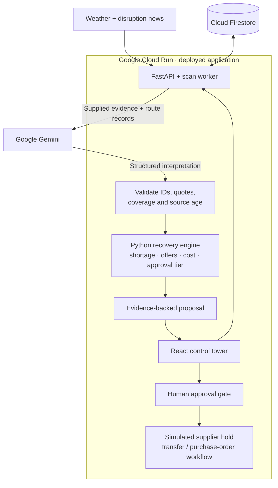

<div align="center">

# SignalBridge

### From disruption signals to evidence-backed retail recovery decisions.

**Google Cloud AI Builder Cup 2026 · Team BuildX · Retail & Commerce**


[**Open the live application**](https://signalbridge-b7xrx4k35a-el.a.run.app/) · [**Try the decision walkthrough**](https://signalbridge-b7xrx4k35a-el.a.run.app/#/decision-demo) · [API documentation](https://signalbridge-b7xrx4k35a-el.a.run.app/docs)

</div>

---

## The problem: an alert is not yet a recovery decision

A port closure can look urgent while leaving a retailer's orders fully covered. A cancelled strike can still contain every disruption keyword. And a cheaper backup supplier can sail through the same channel that caused the original delay.

Retail planners must connect external reports to shipment routes, customer deadlines, available stock and supplier commitments before deciding whether to act. That information is spread across different records, while an unnecessary emergency purchase can create its own cost and surplus problem.

**SignalBridge connects the evidence to the customer commitment.** Gemini interprets what a notice means and which shipments it concerns. A deterministic Python engine calculates the resulting shortage, checks internal stock and supplier options, and prepares a recovery proposal for human approval.

> **Interpret the signal. Calculate the impact. Explain the options. Keep the human in control.**

## What a planner can do

| Planner question | SignalBridge's response |
|---|---|
| Does this disruption concern our shipment? | A structured Gemini interpretation with route relevance, event status, exact source excerpts and uncertainty. |
| Which customer commitment is exposed? | Deadline-based supply, demand and shortage calculations under the stored arrival scenario. |
| Can we use our own stock first? | Internal on-hand-minus-reserved availability, followed by external sourcing for the remainder. |
| Why choose this supplier? | A comparison of available quantities, delivery dates, quote expiry, cost and disrupted-route exclusions, including rejection reasons. |
| Is the proposed recovery worth reviewing? | An estimated recovery-benefit check, a surplus warning and a spend-based approval tier. |
| Can I inspect or question the recommendation? | An evidence-backed decision brief, a network-wide Gemini assistant and plan-specific questions. |

## Start here: a decision you can reproduce

Open the [**Decision walkthrough**](https://signalbridge-b7xrx4k35a-el.a.run.app/#/decision-demo). Both cases use the same synthetic retail records: a 100-unit coffee order, 20 units on hand, 80 inbound units, 20 units at another DC and two backup offers.

| Same business records, different notice | Calculated outcome |
|---|---|
| **Active channel closure** | Under the declared disrupted-arrival assumption, an **80-unit shortage**. The proposal uses **20 internal units + 60 supplier units**, at an external cost of **₹3,700**. A cheaper sea offer is rejected because it crosses the disrupted passage. |
| **Strike cancelled before it starts** | The supplied event does not justify delaying the inbound shipment: **no additional shortage and no new purchase proposal**. |

An independent inland shipment is excluded from both notices. This makes the AI contribution visible: the meaning and route relevance of the evidence influence the decision before code calculates the recovery.

1. Use **Reference replay** to inspect an authored example without a model call.
2. Select **Assess with Gemini** to run an actual interpretation of the supplied notice. Inspect the reported model, exact quotes and execution time.
3. Switch notices and compare the interpretation, shortage and sourcing outcome.
4. Expand the source evidence and calculation assumptions before drawing a conclusion.

The walkthrough uses a **fixed scenario clock: 17 October 2026, 09:00 UTC**, and a new private snapshot for every run. It does not reset operational Firestore data, reserve stock, send emails or execute a purchase. A live-model failure is shown as unavailable/review-required; the reference answer is never silently substituted.

**These are synthetic decision examples, not measured customer savings or an AI accuracy benchmark.** [Walkthrough details →](docs/decision_walkthrough.md)

## Built with Google: each product has a defined role

The live service, Firestore connectivity, regional build history and container repository were checked on **17 October 2026**. The table distinguishes deployed infrastructure from optional integrations and planned work.

| Google product | Status | Role in SignalBridge | Implementation / evidence |
|---|---|---|---|
| **Gemini API** | **Integrated** | Interprets operational evidence; returns structured shipment assessments; explains plans and answers network-wide and plan-specific questions. | [Gemini integration](backend/ai/gemini.py), [typed output contract](backend/models/decision.py). The live walkthrough exposes the actual model source when an assessment succeeds. |
| **Google Cloud Run** | **Deployed** | Hosts the FastAPI API and built React dashboard in one containerized service. | [Live application](https://signalbridge-b7xrx4k35a-el.a.run.app/), [health endpoint](https://signalbridge-b7xrx4k35a-el.a.run.app/health), [application entry point](backend/app/main.py). |
| **Cloud Firestore** | **Live operational store** | Stores tenant-scoped business records, signals, shipment assessments and reservation operations. Derived plan figures are calculated when needed. | [FirestoreStore](backend/core/store.py). The live health endpoint reported `data_backend: firestore` and a reachable database. |
| **Cloud Build** | **Used for deployment builds** | Builds the deployable application container. | Successful regional builds were verified in `asia-south1` for the `signalbridge` image. This is build infrastructure, not the AI reasoning layer. |
| **Artifact Registry** | **Used by the deployed service** | Stores the container image consumed by Cloud Run. | The deployed image points to the `cloud-run-source-deploy` Docker repository in `asia-south1`. |
| **Google Agent Development Kit (ADK)** | **Implemented, optional path** | Provides a runnable tool-using agent for location weather and news checks. | [ADK agent](backend/agent/agent.py), [tools](backend/agent/tools.py). The main web assessment and chat paths call the Gemini REST integration directly; they are not an ADK multi-agent pipeline. |
| **Firebase Hosting** | **Configured alternative** | Can host the separately built React frontend when deploying it independently of Cloud Run. | [Hosting configuration](firebase.json). The linked live application currently uses Cloud Run; this README does not claim a separate live Hosting deployment. |
| **Google News RSS** | **Implemented news fallback** | Supplies disruption headlines when the primary GDELT provider is unavailable. | [News adapter](backend/adapters/news.py). This is an external information source, not a managed Google Cloud AI service. |
| **Google Cloud Scheduler** | **Planned — not currently used** | Will trigger the existing scan endpoint on a schedule, without requiring a dashboard visit. | Current behavior and the planned authenticated integration are described below. |

Gemini keys can be obtained through [Google AI Studio](https://aistudio.google.com/apikey). The current application uses the **Gemini API key / REST path**, not a claimed Vertex AI or Agent Engine deployment.

### Cloud Scheduler: current behavior and next step

**Cloud Scheduler is not enabled in the current application.** To control demonstration costs and quota consumption, the operational dashboard requests `POST /scan` on page load or refresh. Scans are throttled by `SCAN_MIN_INTERVAL_SECONDS` (default **600 seconds**), so a refresh does not necessarily start a new scan.

An optional in-process loop exists, but `SIGNAL_SCAN_INTERVAL_SECONDS=0` disables it by default. That loop is not Cloud Scheduler. Direct visits to the isolated walkthrough do not trigger the operational page-load scan.

The planned production trigger is:

```text
Google Cloud Scheduler
    → authenticated POST /scan on Cloud Run
    → fetch weather/news → validate Gemini assessment → update risk and exposure
```

Before enabling it, add and verify service-account/OIDC authorization for the scan endpoint, configure an appropriate cadence, retries and request timeout, and test the workflow with nobody viewing the dashboard. Scheduled, unattended monitoring and any additional automatic alert-delivery policy must be validated before being claimed as live capabilities.

## Architecture: AI interpretation, deterministic decisions



The diagram shows the main application path. The optional ADK agent, alternative Firebase Hosting deployment and future Scheduler trigger are described separately so they are not mistaken for active orchestration layers.

### Where generative AI adds value

Gemini interprets whether the supplied text describes an active, planned, cancelled or uncertain event and explains its relevance to known shipment routes. The global assistant helps a planner explore the network; plan-specific questions help inspect an individual proposal.

The model does **not** calculate the authoritative quantities, prices, recovery cost or approval tier. Those come from Python domain functions. Structured output is checked for complete shipment coverage, valid supplied IDs, exact source quotes, source freshness and route-linked support for affected decisions. Unknown or unavailable assessments do not silently mark an existing risky shipment safe.

These checks validate the output contract and grounding references; they do not prove that every interpretation is factually correct. The UI exposes uncertainty and policy overrides for review.

## Alignment with the judging rubric

The [official judging criteria](https://aibuildercup.com/themes.html) use the following weights. These are the project's evidence points, not a prediction of its score.

| Criterion | Weight | What a judge can inspect |
|---|---:|---|
| Technical merit & generative AI | **40%** | Working Gemini interpretation, structured validation, saved evidence references, deterministic calculations, Cloud Run deployment and Firestore integration. |
| Problem alignment & impact | **25%** | A retail order deadline connected to route disruption, shortage, internal availability and a reviewable recovery cost. The intended value is fewer missed commitments and unnecessary emergency purchases; field impact is not yet measured. |
| Innovation & creativity | **25%** | An active-versus-cancelled notice comparison, unrelated-route exclusion, internal-stock-first recovery and rejection of a cheaper offer that repeats the original route risk. |
| User experience & solution design | **10%** | An inspectable evidence-to-decision flow, source timestamps, visible assumptions, supplier rejection reasons, conversational questions and an explicit approval step. |

## Run locally

**Requirements:** Python 3.10+, Node.js 18+ and [uv](https://docs.astral.sh/uv/). Run these commands from a checkout of this repository.

```bash
# Terminal 1 — local fixtures, no Firestore credentials required
uv sync --extra dev
DATA_BACKEND=local SIGNAL_SCAN_INTERVAL_SECONDS=0 \
  uv run uvicorn backend.app.main:app --reload --port 8000
```

```bash
# Terminal 2 — React dashboard
cd frontend
npm ci
npm run dev
```

Open [the local walkthrough](http://localhost:5173/#/decision-demo). **Reference replay needs no Gemini key.** Live Gemini interpretation and the assistants require a valid key and available model quota. Configure `GOOGLE_API_KEY` in a local `.env`; never commit it. See [setup instructions](docs/start.md) for the pip alternative and Firestore configuration.

### Build and test

```bash
# Cloud-free regression run
DATA_BACKEND=local GOOGLE_API_KEY='' GOOGLE_API_KEY_2='' uv run python -m pytest -q

# Terminal recovery-engine demonstration
DATA_BACKEND=local uv run python -m scripts.demo

# Production frontend build
cd frontend
npm run build
```

The tests cover domain calculations, evidence validation, active/cancelled examples, incomplete assessments, quote expiry, supplier allocation and snapshot isolation. Mocked tests and reference replays establish reproducible behavior; they do not establish live model accuracy. Individual model response times are execution observations, not an aggregate performance claim.

The repository also contains a multi-stage `Dockerfile` for the combined Cloud Run service and a `firebase.json` for separate frontend hosting. A Firebase-hosted frontend must be built with `VITE_API_BASE` set to its deployed API URL; the combined container uses a same-origin API base.

## Operating boundaries

- **Synthetic business data:** the walkthrough's notices, retail records and offers are demonstration data. Live weather/news are separate external inputs; a headline is not a verified carrier delay.
- **Assumed arrival impact:** disrupted-arrival values are stored scenario assumptions, not ETAs predicted by Gemini. Missing remaining-leg timing needs review.
- **Financial estimate, not profit:** the recovery-benefit check compares exposed revenue plus potential penalties with external recovery cost. It is not a complete contribution-margin model or a claim of realized savings.
- **Internal stock needs review:** availability currently means on-hand minus reserved stock. Donor demand, internal transfer time/cost and network-wide optimization are not fully modeled.
- **Controlled execution:** supplier holds are simulated. Email delivery is simulated by default, with optional SMTP configuration. A generated transfer or purchase order is not proof that goods were bought or delivered.
- **Persistence and access:** operational records and reservation operations can use Firestore; the current fulfilment timeline is process-local. Production authentication, authorization and execution controls require further hardening.

## Focused next steps

1. Enable authenticated Cloud Scheduler-driven monitoring and validate unattended alert delivery.
2. Measure live Gemini interpretation on a labelled evaluation set, including false alerts, missed disruptions, abstentions and evidence validity.
3. Add read-only what-if comparisons for waiting, supplier exclusion and alternative recovery proposals.
4. Model donor demand and internal transfer feasibility; integrate real carrier/supplier confirmations only behind appropriate approval and idempotency controls.

## Explore the implementation

```text
backend/ai/          Gemini REST integration, context and explanations
backend/agent/       Optional Google ADK agent and tools
backend/domain/      Deterministic exposure, planning, evidence and approval logic
backend/core/        Configuration and local / snapshot / Firestore stores
backend/app/         FastAPI routes and built-dashboard serving
backend/worker/      Signal collection and monitoring workflow
frontend/            React control tower
fixtures/            Business data and isolated decision examples
tests/               Regression tests
docs/                Setup, calculations and implementation notes
```

| Read next | Purpose |
|---|---|
| [Decision walkthrough](docs/decision_walkthrough.md) | Reproduce the two cases and understand the evidence contract. |
| [Local setup](docs/start.md) | Install and run the API, frontend and optional ADK agent. |
| [Calculations](docs/calculation.md) | Inspect the deterministic recovery calculations. |
| [Data contract](docs/schema.md) | Understand stored records and decision-evidence fields. |
| [Frontend setup](docs/frontend_setup.md) | Build the dashboard and configure separate Firebase Hosting. |
| [Repository rules](AGENTS.md) | Contribute without moving financial decisions into model output. |

---

**SignalBridge · Clear evidence. Calculated recovery. Human control.**
