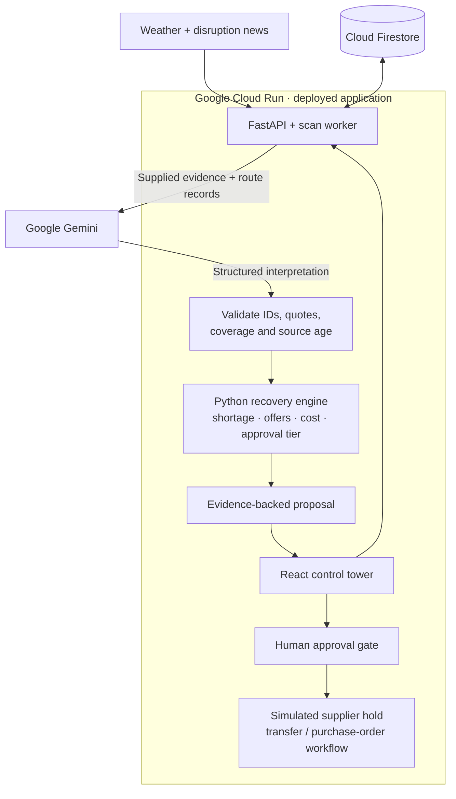

<div align="center">

# SignalBridge

### Retail supply-chain recovery, grounded in evidence and calculated in code.

**Retail & Commerce · Team BuildX · Built with Google Gemini and Google Cloud**


[**Open the live application**](https://signalbridge-b7xrx4k35a-el.a.run.app/) · [**Try the decision walkthrough**](https://signalbridge-b7xrx4k35a-el.a.run.app/#/decision-demo) · [API documentation](https://signalbridge-b7xrx4k35a-el.a.run.app/docs)

</div>

---

## The problem

A delayed shipment matters when it threatens a customer commitment. A disruption alert alone does not tell a retail planner which orders will be short, whether another warehouse can help, or which backup supplier can deliver before the deadline.

Answering those questions means connecting news and weather reports with shipment routes, inventory, order deadlines and supplier offers. Those records describe different parts of the problem, leaving planners to reconstruct the impact before they can choose a response.

A keyword alert can also be misleading: a cancelled strike still mentions disruption, an unrelated port closure may not affect the shipment, and the cheapest backup offer may cross the same blocked route. Acting too quickly can create unnecessary purchases and surplus. Acting too late can leave customer orders uncovered.

## The solution

**SignalBridge connects external disruption evidence to a retail recovery proposal.** Google Gemini interprets the supplied evidence and its relevance to known shipment routes. Deterministic Python functions calculate deadline-based shortages, inspect internal stock, compare supplier offers and assign the approval tier. A planner can review the evidence and calculations before approving the supported recovery workflow.

The aim is to help operations teams protect customer commitments while avoiding unnecessary emergency sourcing. These are intended benefits, not claims of measured customer savings.

### How a recovery decision is built

1. **Collect disruption signals.** Fetch weather/news for in-transit destinations and active ports/sea waypoints, retaining source references and timestamps. Interpret relevance against each supplied shipment's route.
2. **Interpret the evidence with Gemini.** Distinguish active, planned, cancelled and uncertain events, and assess their relevance to supplied shipment records.
3. **Calculate the customer impact.** Compare stock and incoming supply with demand due by the order deadline, using the declared arrival scenario.
4. **Prepare a recovery proposal.** Inspect available internal stock first, then select the lowest-cost external offer that can cover the remainder within the modeled constraints.
5. **Support a controlled decision.** Show source excerpts, supplier rejection reasons, estimated recovery benefit, surplus exposure and the required approval tier. Money-moving actions remain behind an explicit approval step.

## What a planner can do

| Planner question | SignalBridge's response |
|---|---|
| Does this disruption concern our shipment? | A structured Gemini interpretation with route relevance, event status, exact source excerpts and unresolved information. |
| Which customer commitment is exposed? | Deadline-based supply, demand and shortage calculations under the stored arrival scenario. |
| Can we use our own stock first? | Internal on-hand-minus-reserved availability, followed by external sourcing for the remainder. |
| Why choose this supplier? | A comparison of available quantities, delivery dates, quote expiry, cost and disrupted-route exclusions, including rejection reasons. |
| Is the proposed recovery worth reviewing? | An estimated recovery-benefit check, a surplus warning and a spend-based approval tier. |
| Can I inspect or question the recommendation? | An evidence-backed decision brief, a network-wide Gemini assistant and plan-specific questions. |

## Decision walkthrough

The [**Decision walkthrough**](https://signalbridge-b7xrx4k35a-el.a.run.app/#/decision-demo) shows why the meaning of a notice matters. Both cases use the same synthetic retail records: a 100-unit coffee order, 20 units on hand, 80 inbound units, 20 units at another distribution center and two backup offers.

| Same business records, different notice | Calculated outcome |
|---|---|
| **Active channel closure** | Under the declared disrupted-arrival assumption, an **80-unit shortage**. The proposal uses **20 internal units + 60 supplier units**, at an external cost of **₹3,700**. A cheaper sea offer is rejected because it crosses the disrupted passage. |
| **Strike cancelled before it starts** | The supplied event does not justify delaying the inbound shipment: **no additional shortage and no new purchase proposal**. |

An unrelated inland shipment is excluded from both notices. The evidence interpretation changes which shipment is considered disrupted. Python then calculates the business impact and recovery proposal from the same underlying records.

1. Use **Reference replay** to inspect an authored example without a model call.
2. Select **Assess with Gemini** to run an actual interpretation of the supplied notice. Inspect the reported model, exact quotes and execution time.
3. Switch notices and compare the interpretation, shortage and sourcing outcome.
4. Expand the source evidence and calculation assumptions before drawing a conclusion.

The walkthrough uses a **fixed scenario clock: 17 October 2026, 09:00 UTC**, and a new private snapshot for every run. It does not reset operational Firestore data, reserve stock, send emails or execute a purchase. A live-model failure is shown as unavailable/review-required; the reference answer is never silently substituted.

**These are synthetic decision examples, not measured customer savings or an AI accuracy benchmark.** [Walkthrough details →](docs/decision_walkthrough.md)

## Google products and their roles

Gemini provides evidence interpretation and conversational assistance. Google Cloud provides the application runtime, operational data store and container deployment infrastructure. Optional integrations and planned services are identified separately below.

| Google product | Integration status | Role in SignalBridge | Implementation |
|---|---|---|---|
| **Gemini API** | **Integrated** | Interprets operational evidence, returns structured shipment assessments, explains plans and answers network-wide or plan-specific questions. | [Gemini integration](backend/ai/gemini.py), [typed output contract](backend/models/decision.py). Successful live walkthrough assessments display their model source. |
| **Google Cloud Run** | **Deployed** | Hosts the FastAPI API and built React dashboard in one containerized service. | [Live application](https://signalbridge-b7xrx4k35a-el.a.run.app/), [health endpoint](https://signalbridge-b7xrx4k35a-el.a.run.app/health), [application entry point](backend/app/main.py). |
| **Cloud Firestore** | **Operational store** | Stores tenant-scoped business records, signals, shipment assessments and reservation operations. Derived plan figures are calculated when needed. | [FirestoreStore](backend/core/store.py), [health endpoint](https://signalbridge-b7xrx4k35a-el.a.run.app/health). Local JSON and private snapshot stores support development and isolated replay. |
| **Cloud Build** | **Deployment builds** | Builds the application container for deployment to Cloud Run. | The deployment uses regional builds in `asia-south1`. The [multi-stage Dockerfile](Dockerfile) packages the React build and Python API. |
| **Artifact Registry** | **Deployment image storage** | Stores the container image consumed by Cloud Run. | The deployment uses the regional `cloud-run-source-deploy` Docker repository in `asia-south1`. |
| **Google Agent Development Kit (ADK)** | **Implemented, optional path** | Provides a runnable tool-using agent for location weather and news checks. | [ADK agent](backend/agent/agent.py), [tools](backend/agent/tools.py). The main web assessment and chat paths call the Gemini REST integration directly; they are not an ADK multi-agent pipeline. |
| **Firebase Hosting** | **Configured alternative** | Can host the separately built React frontend when deploying it independently of Cloud Run. | [Hosting configuration](firebase.json). The linked application is hosted on Cloud Run, not a separate Firebase Hosting deployment. |
| **Google News RSS** | **Implemented news fallback** | Supplies disruption headlines when the primary GDELT provider is unavailable. | [News adapter](backend/adapters/news.py). This is an external information source, not a managed Google Cloud AI service. |
| **Google Cloud Scheduler** | **Planned** | Trigger the scan endpoint on a schedule, without requiring a dashboard visit. | Requires authenticated integration and unattended-workflow validation before activation. |

Gemini keys can be configured through [Google AI Studio](https://aistudio.google.com/apikey). The application calls the **Gemini REST API with API keys**. Vertex AI and Agent Engine are not part of the current deployment.

## Technical stack

| Layer | Technology | Responsibility |
|---|---|---|
| Frontend | React 18, Vite 5, React Router, Leaflet | Control tower, network map, shipments, incidents, recovery proposals and decision walkthrough. |
| API | Python 3.10+, FastAPI, Uvicorn, Pydantic 2 | Typed requests, evidence validation and endpoints for planning, chat, scanning and approval. |
| Business logic | Pure Python domain functions | Exposure, internal availability, supplier feasibility, cost calculations, surplus estimates and governance. Money uses integer minor units and quantities use whole integers. |
| Data | Cloud Firestore, local JSON, in-memory snapshots | Operational persistence, cloud-free development and isolated scenario replay. |
| External signals | Open-Meteo, GDELT, Google News RSS | Weather forecasts and disruption headlines, with a fallback news provider. |
| Packaging and tests | Docker, pytest, Ruff | Combined application container, regression tests and code checks. |

### Monitoring and quota controls

The operational dashboard requests `POST /scan` on page load or refresh. Scans are throttled by `SCAN_MIN_INTERVAL_SECONDS` (default **600 seconds**) within each API process, so a refresh does not necessarily start another scan. The news adapter caches successful results, and the Gemini integration supports model/key failover with cooldowns after quota failures. These controls reduce repeated requests but do not guarantee a fixed bill or a deployment-wide rate limit.

An optional in-process loop is disabled by default with `SIGNAL_SCAN_INTERVAL_SECONDS=0`. Direct visits to the isolated walkthrough do not trigger the operational page-load scan. **Cloud Scheduler is planned, not active.**

The planned production trigger is:

```text
Google Cloud Scheduler
    → authenticated POST /scan on Cloud Run
    → fetch weather/news → validate Gemini assessment → update risk and exposure
```

Enabling this path requires service-account/OIDC authorization for the scan endpoint, an appropriate cadence, retries and request timeout. Unattended monitoring and automatic alert delivery must be tested independently of dashboard visits.

## Architecture



The diagram shows the main web application path. The optional ADK agent, alternative Firebase Hosting configuration and planned Scheduler trigger are separate integrations.

### The AI boundary

Gemini interprets whether the supplied text describes an active, planned, cancelled or uncertain event and explains its relevance to known shipment routes. The global assistant helps a planner explore the network; plan-specific questions help inspect an individual proposal.

The model does **not** calculate the authoritative quantities, prices, recovery cost or approval tier. Those come from Python domain functions. Structured output is checked for complete shipment coverage, valid supplied IDs, exact source quotes, source freshness and route-linked support for affected decisions. Unknown or unavailable assessments do not silently mark an existing risky shipment safe.

These checks validate the output contract and grounding references; they do not prove that every interpretation is factually correct. The UI exposes uncertainty and policy overrides for review.

## Run locally

**Requirements:** Python 3.10+, Node.js 18+ and [uv](https://docs.astral.sh/uv/). Run these commands from a checkout of this repository.

```bash
# Terminal 1 — local fixtures, no Firestore credentials required
uv sync --extra dev
DATA_BACKEND=local SIGNAL_SCAN_INTERVAL_SECONDS=0 \
  uv run uvicorn backend.app.main:app --reload --port 8000
```

```bash
# Terminal 2 — React dashboard
cd frontend
npm ci
npm run dev
```

Open [the local walkthrough](http://localhost:3000/#/decision-demo). Vite development uses port 3000; production preview uses 5173. **Reference replay needs no Gemini key.** Live Gemini interpretation and the assistants require a valid key and available model quota. Configure `GOOGLE_API_KEY` in a local `.env`; never commit it. See [setup instructions](docs/start.md) for the pip alternative and Firestore configuration.

### Build and test

```bash
# Local regression run (dummy key enables mocked model paths, not live Gemini)
DATA_BACKEND=local GOOGLE_API_KEY=offline-test-key GOOGLE_API_KEY_2='' \
  SIGNAL_SCAN_INTERVAL_SECONDS=0 uv run python -m pytest -q

# Terminal recovery-engine demonstration
DATA_BACKEND=local uv run python -m scripts.demo

# Production frontend build
cd frontend
npm run build
```

The tests cover domain calculations, evidence validation, active/cancelled examples, incomplete assessments, quote expiry, supplier allocation and snapshot isolation. Model integration tests use mocks and the regression command uses a non-secret dummy key. Reference replay also makes no model call.

### Reproducible validation

The [offline benchmark](tests/benchmark/README.md) compares planner results with an independent calculator reading raw records. It covers the stored snapshot and a controlled disruption scenario, mocked failure handling, and deliberately injected faults that test the checker itself. The default benchmark blocks outbound connections and uses private sample-data snapshots.

```bash
DATA_BACKEND=local GOOGLE_API_KEY='' GOOGLE_API_KEY_2='' \
  uv run python tests/benchmark/benchmark.py --runs 5000 \
  --output-dir ../output/benchmark
```

See the [recorded benchmark report](tests/benchmark/report.md) and [detailed results](tests/benchmark/results.json) for the dataset, run time, comparisons and scope. These are local computation and documented-policy checks, not deployed API latency, live Gemini accuracy, production capacity or measured business outcomes. Use `--gemini` only when intentionally running live assessments and consuming model quota.

The repository also contains a multi-stage `Dockerfile` for the combined Cloud Run service and a `firebase.json` for separate frontend hosting. A Firebase-hosted frontend must be built with `VITE_API_BASE` set to its deployed API URL; the combined container uses a same-origin API base.

## Operating boundaries

- **Synthetic business data:** the walkthrough's notices, retail records and offers are demonstration data. Live weather/news are separate external inputs; a headline is not a verified carrier delay.
- **Assumed arrival impact:** disrupted-arrival values are stored scenario assumptions, not ETAs predicted by Gemini. Missing remaining-leg timing needs review.
- **Financial estimate, not profit:** the recovery-benefit check compares exposed revenue plus potential penalties with external recovery cost. It is not a complete contribution-margin model or a claim of realized savings.
- **Internal stock needs review:** availability currently means on-hand minus reserved stock. Donor demand, internal transfer time/cost and network-wide optimization are not fully modeled.
- **Controlled execution:** supplier holds are simulated. Email delivery is simulated by default, with optional SMTP configuration. A generated transfer or purchase order is not proof that goods were bought or delivered.
- **Persistence and access:** operational records and reservation operations can use Firestore; the current fulfilment timeline is process-local. Production authentication, authorization and execution controls require further hardening.
- **Execution limits:** approval saves plan/operation records but does not transactionally allocate donor stock, update order coverage or append a stock ledger. Sequential reservation retries can reuse an operation, but email attempts can repeat. Internal-only recovery execution remains planned.

## Roadmap

1. Enable authenticated scheduled monitoring, role-enforced approvals and deduplicated notifications.
2. Add transactional inventory allocation, durable fulfilment and donor-safe/internal-only recovery.
3. Measure live Gemini interpretation on a labelled evaluation set, including false alerts, missed disruptions, abstentions and evidence validity.
4. Add read-only what-if comparisons and authorized carrier/supplier confirmations within the existing architecture.

See the [roadmap and completion criteria](docs/roadmap.md). VIP/SLA allocation, claims support, perishables rescue and mobile alerts remain later business extensions, not active workflows.

## Explore the implementation

```text
backend/ai/          Gemini REST integration, context and explanations
backend/agent/       Optional Google ADK agent and tools
backend/domain/      Deterministic exposure, planning, evidence and approval logic
backend/core/        Configuration and local / snapshot / Firestore stores
backend/app/         FastAPI routes and built-dashboard serving
backend/worker/      Signal collection and monitoring workflow
frontend/            React control tower
fixtures/            Business data and isolated decision examples
tests/               Regression tests
docs/                Setup, calculations and implementation notes
```

| Read next | Purpose |
|---|---|
| [Documentation index](docs/README.md) | Current architecture, implementation status and operating guidance. |
| [Roadmap](docs/roadmap.md) | Separate current foundations, remaining safeguards and future extensions. |
| [Decision walkthrough](docs/decision_walkthrough.md) | Reproduce the two cases and understand the evidence contract. |
| [Local setup](docs/start.md) | Install and run the API, frontend and optional ADK agent. |
| [Calculations](docs/calculation.md) | Inspect the deterministic recovery calculations. |
| [Data contract](docs/schema.md) | Understand stored records and decision-evidence fields. |
| [Frontend setup](docs/frontend_setup.md) | Build the dashboard and configure separate Firebase Hosting. |
| [Repository rules](AGENTS.md) | Contribute without moving financial decisions into model output. |

---

**SignalBridge · Retail recovery with traceable evidence and human approval.**
