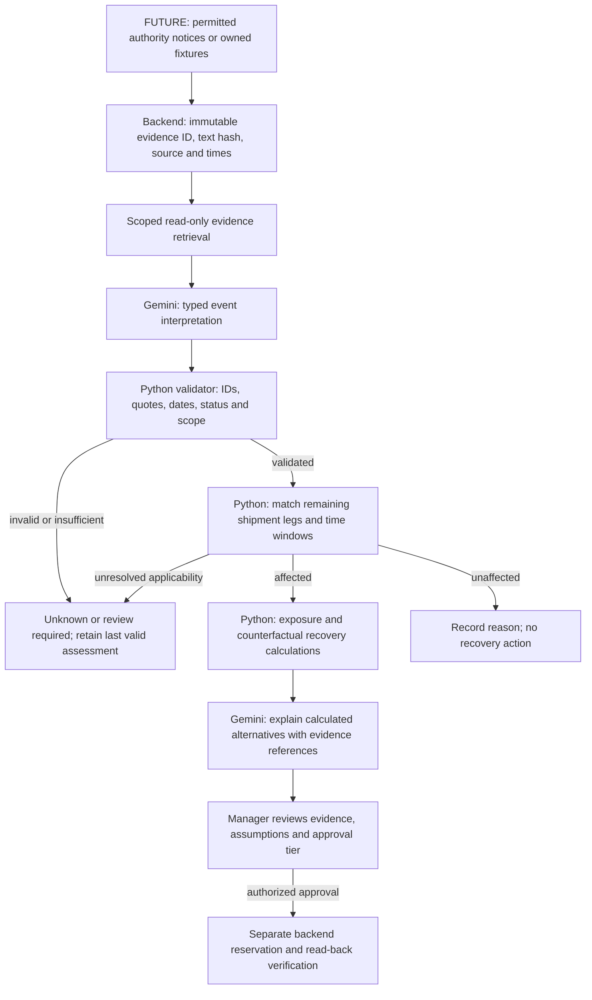

# Gemini improvements for SignalBridge

Reviewed on **13 October 2026**. This document distinguishes the running code from proposed improvements. Only this document was added; application code, tests, configuration, credentials, and cloud resources were not changed. No model or paid cloud call was made during the review.

## 1. The strongest next addition

Build **evidence-linked event interpretation**, then apply it to a shipment's remaining route and calculate recovery alternatives in Python.

The useful question is: **“Does this specific notice change what we can deliver to these customers, and what is the least costly feasible response?”** Gemini should interpret the notice's language, scope, dates, and cancellation/reopening status. Code should validate the interpretation, match the affected legs, calculate shortages and alternatives, and enforce approval.

This adds value to the real problem statement. A summary of news or a polished explanation of an existing plan is less convincing than showing why one notice threatens an order while another similar notice does not.

## 2. What the current code actually does

Paths below are relative to this repository. Line anchors describe the code reviewed, not a future implementation.

| Path | Observed behavior | Accurate claim |
|---|---|---|
| `backend/app/main.py:13` | Starts an in-process signal scan loop while the API is running. | Background monitoring inside the API process. |
| `backend/worker/main.py:26` | Fetches weather/news, stores signals, and calls Gemini at line 74. | External signals can feed automatic AI triage. |
| `backend/ai/gemini.py:134` | Sends a batch of shipments, route names, weather summaries, and selected news titles to Gemini. Returns `shipment_id`, `risk`, and `reason`. | Gemini makes semantic shipment-risk judgments, beyond explanations. |
| `backend/domain/triage.py:119` | Applies model judgments to shipment risk flags, then computes exposures. | A model judgment can change the downstream shortage calculation. |
| `backend/worker/main.py:94` | Runs deterministic recovery planning after a successful judgment. | Planning can follow triage without a manual button press. |
| `backend/ai/gemini.py:209` and `:214` | Explains an already-calculated plan and answers questions from assembled context. | Gemini provides explanations and contextual Q&A. |
| `backend/agent/agent.py:19` | Defines one optional ADK `LlmAgent` with weather/news tools. | An optional tool-using Signal Scout is defined. |
| `backend/app/routers/plans.py:47` | Handles approval and invokes reservation/fulfillment code separately from Gemini. | The UI approval path initiates simulated fulfillment; authentication is explicitly still TODO in this route. |

**Gemini is already meaningful:** the worker uses its risk classification to drive exposures and planning. However, it does not currently extract a validated event record, cite exact supporting evidence, compare recovery scenarios through tools, or run the documented two-agent ADK pipeline.

### Current Gemini API versus the original cloud blueprint

`backend/ai/gemini.py:27` calls the **Gemini Developer API** at `generativelanguage.googleapis.com/v1beta/models/{model}:generateContent`, using an API key. This is not the Cloud inference endpoint from the original blueprint. The configured Google Cloud project does not change which model endpoint this function uses.

The running application calls this REST helper directly. It does not import the optional ADK agent into its scan or assistant routes. `TRIAGE` and `RECOVERY` instructions exist in `backend/agent/prompts.py:13` and `:23`, but no matching agents are instantiated in `backend/agent/agent.py`.

`docs/agents.md:109` describes a `SequentialAgent` and its earlier sections describe two agents. Those are blueprint descriptions, not the current runtime. The original Cloud Scheduler, managed worker, and multi-agent diagram should also be labelled proposed wherever they are still presented.

The current calls contain no Google Search grounding tool or custom function declarations. “Grounded in app data” means that the code supplies context to the prompt. Google News RSS is a news adapter, not Gemini's Google Search grounding feature. No vector database is necessary for the proposed improvement.

## 3. Verified problems and prioritized fixes

| Priority | Observed code and problem | Proposed change and proof |
|---|---|---|
| **P0** | `gemini.py:366` silently drops unknown IDs, accepts duplicates, and interprets missing/non-boolean `risk` as false. `triage.py:127` treats an omitted shipment as safe. | Strictly validate types, unique IDs, and required coverage. Invalid, incomplete, blocked, or timed-out output becomes **unknown/stale**, not a new safe decision. Preserve the last valid judgment with its age. Add parser and state-transition tests. |
| **P0** | `_call()` at `gemini.py:43` requests JSON MIME type without a response schema. At line 81 it reads only the first text part and does not inspect completion status. | Use a documented schema interface for the selected API/SDK; validate again in Python. Check completion status, aggregate supported non-thought text parts, and reject incomplete responses. Add bounded output and total request deadlines. |
| **P0** | `_news_brief()` at `gemini.py:346` omits signal IDs and source/publication times. `_weather_brief()` at line 331 omits forecast validity/fetch age. `_shipment_brief()` at line 311 lacks remaining-leg timing. | Pass stable evidence IDs, permitted source excerpts, fetch/publication/effective times, forecast windows, and remaining leg IDs/times. Require an evidence link for every interpretation used operationally. |
| **P1** | News queries require disruption keywords (`adapters/news.py:50`), and Gemini receives only keyword-qualified titles (`gemini.py:161`, `domain/network.py:25`). | Add a bounded, permitted authority-notice/owned-fixture input that is not rejected by a keyword gate. Keep keyword search as discovery. Demonstrate a paraphrase and a cancelled closure that keyword matching mishandles. |
| **P1** | Risk is a boolean plus a sentence. Exposure records have `event_id: None` (`triage.py:239`); no interpreted event is persisted by this path. | Create a validated event revision linked to evidence. Keep planned, active, cancelled, reopened, uncertain, and expired states distinct. Link assessments and exposures to that revision. |
| **P1** | The prompt sees all lane point names (`gemini.py:154`) and treats recent attacks as risk despite recovery reports (`:194`). It cannot establish whether the ship already passed that place or whether a later notice supersedes an earlier one. | Match interpreted scope/status against **remaining** legs and event validity in code. A reopening notice supersedes only the matching incident/scope; ambiguous conflicts remain unknown. |
| **P1** | Plan Q&A explicitly permits model arithmetic (`gemini.py:122`), contrary to `AGENTS.md:11`. | Precompute normal/recovery margins and cost comparisons in domain code. Give Gemini the resulting values and rationale; do not ask it to derive monetary answers. |
| **P1** | `tests/test_triage.py:135` supplies handcrafted model judgments; it does not test whether Gemini interprets notices correctly. | Add a labelled, held-out interpretation set and an end-to-end synthetic replay. Report false positives, missed disruptions, abstentions, latency, and token usage. |
| **P2** | The optional ADK agent is disconnected from the automatic application path. | After the P0 fixes, wire an actual bounded ADK workflow to the worker, or accurately pitch the existing REST workflow. Show real execution events; avoid adding agents solely to increase the count. |

Offline reproduction during this review used the repository's parser and judgment-selection functions with synthetic inputs. Empty arrays, unknown-ID-only rows, missing risk, `risk: "true"`, and contradictory duplicate rows all produced a safe decision for `SHP-001`. No model or database request was involved.

Google's [structured-output guidance](https://ai.google.dev/gemini-api/docs/structured-output) describes typed schemas and application validation; valid JSON is insufficient to establish correct facts. The [generateContent reference](https://ai.google.dev/api/generate-content) documents completion reasons and output-format controls. Its current schema fields include deprecations in favor of `responseFormat`; confirm the chosen SDK/API interface instead of mixing old and new request shapes.

### Related domain correction needed for credible AI results

`triage.py:220` selects a disrupted scenario for a SKU/location if any shipment is risky. `domain/exposure.py:75` then applies `assumed_arrival_at` to every relevant shipment having that field, even if its own risk flag is safe. Restrict scenario changes to matched shipments. Otherwise a correct model interpretation can still produce a wrong shortage.

`domain/planner.py:50` derives blocked chokepoints from risky shipments plus disruptive signals, rather than an explicit evidence-to-leg assessment. Use the validated matching result to avoid excluding a supplier because an unrelated notice happens to mention a shared route.

## 4. Proposed event interpretation contract

**Future contract; not an existing API or implemented model.** Event IDs, hashes, revision numbers, model/run metadata, and validation results are assigned by the backend. Gemini chooses only candidate location IDs and evidence IDs supplied in its input. Unknown dates remain null; publication time must not substitute for an effective time.

Owned synthetic notice used in this example:

> Loading at Nhava Sheva is suspended from 13 Oct 2026 09:00 UTC until 14 Oct 2026 18:00 UTC.

The backend supplies the candidate location `IN-JNPA`, evidence ID `SIG-DEMO-NOTICE-001`, and assessment time `2026-10-13T10:00:00Z`. These are local demonstration IDs and fictional operations, not a real port incident.

```json
{
  "event_type": "operations_suspension",
  "event_status": "active",
  "candidate_location_id": "IN-JNPA",
  "affected_operation": "loading",
  "effective_from": "2026-10-13T09:00:00Z",
  "effective_until": "2026-10-14T18:00:00Z",
  "evidence": [
    {
      "signal_id": "SIG-DEMO-NOTICE-001",
      "quote": "Loading at Nhava Sheva is suspended from 13 Oct 2026 09:00 UTC until 14 Oct 2026 18:00 UTC.",
      "supports_fields": [
        "event_type",
        "candidate_location_id",
        "affected_operation",
        "effective_from",
        "effective_until"
      ]
    }
  ],
  "unresolved_fields": []
}
```

The backend checks that every quote appears exactly in the permitted evidence text, IDs are allowed, dates parse and are ordered, and the interpreted operation has sufficient support. An exact quote is useful traceability, not automatic proof that the model interpreted it correctly or that the publisher is truthful.

Separately, code produces an applicability assessment: `shipment_id`, `remaining_leg_id`, `event_revision_id`, `decision` (`affected`, `unaffected`, or `unknown`), matched evidence IDs, and a rule-based explanation. A loading suspension must not automatically affect an import-discharge leg. A completed port call is excluded. Missing leg timing requires an explicit assumption or review.

### Cancellation, reopening, and conflicting evidence

- A planned strike is not a confirmed current shutdown. Retain its planned status and effective window.
- A cancellation/reopening must identify the incident, terminal, and operation it supersedes. It does not prove all nearby disruption has ended.
- A recent article about an old event does not make the event recent.
- A newer unrelated attack headline does not override a reopening of a different terminal.
- Stale weather, failed feeds, missing routes, and incomplete model output produce unknown coverage. Do not show them as verified safe.

## 5. Proposed agent and data flow — future

The diagram below is a design proposal. It is **not** the application's current ADK architecture.



Use a bounded controller with clear validation stops. The current [ADK workflow documentation](https://adk.dev/agents/workflow-agents/) recommends graph-based structures for ADK 2.x; sequential templates remain documented. The repository lock file currently lists ADK 2.11.0 (`uv.lock:481`). Test the actual installed runtime before changing the integration.

A useful initial implementation has one interpretation model stage, deterministic validation/calculation stages, and one explanation stage. It does not need an unrestricted planning loop or a team of agents making the same judgment repeatedly.

### Read-only tools and structured stages

Proposed tool contracts:

| Tool | Inputs Gemini may choose | Backend responsibility |
|---|---|---|
| `get_evidence` | Bounded list of supplied signal IDs | Return only permitted evidence in the current tenant/run. |
| `get_remaining_route` | Supplied shipment ID | Return authoritative remaining leg IDs, operations and times, with missing-data flags. |
| `get_calculated_exposure` | Supplied assessment/exposure ID | Compute demand, supply, shortage and assumptions in Python. |
| `compare_recovery_scenarios` | Bounded list of predefined scenario IDs | Calculate stock, deadline, route, price, margin and surplus outcomes from current records. |

Do not accept free-form SQL, arbitrary URLs, a model-selected tenant, model-generated prices, or a claimed approval flag. The existing `margin_tool()` at `backend/agent/tools.py:87` accepts numerical inputs from its caller; prefer an ID-based wrapper that obtains prices and quantities from records before calculation. It is not currently registered on the optional Signal Scout.

Keep retrieval and typed extraction separate initially. [ADK's LlmAgent documentation](https://adk.dev/agents/llm-agents/) warns that combining `output_schema` with tools is model-specific. Supply a validated evidence bundle to a schema-producing stage rather than assuming every tool/schema combination works. Apply backend authorization and argument checks; [ADK safety guidance](https://adk.dev/safety/) documents callbacks and tool controls. A prompt asking the model to ignore malicious text is not an authorization boundary.

## 6. Deterministic counterfactual alternatives

Make the comparison operational rather than conversational. Use code to compare a small predefined set:

| Scenario | Questions code must answer | Gemini's role |
|---|---|---|
| Wait for the original shipment | Which deadlines are missed under a clearly labelled delay assumption? | Explain the consequences and uncertainty. |
| Transfer internal stock | Is it genuinely free, transferable, and able to arrive before the deadline? | Explain why it helps or why it fails. |
| Buy from a backup supplier | Is the quote current, stock sufficient, route feasible, and cost acceptable? | Explain the trade-off using calculated results. |
| Split recovery | Can feasible sources cover the shortage together without double allocation? | Explain the allocation returned by code, if this calculation is implemented. |

Do not invent replacement suppliers or turn an unverified headline into a predicted ETA. Show cost in integer minor units and identify assumed arrival dates. Display baseline, disruption, and recovery coverage separately. “Covered by a verified simulated reservation” is not physical delivery or measured revenue saved.

This is a stronger demonstration than asking Gemini to choose an offer from a spreadsheet: the system connects a changed event to exact records, recalculates feasible outcomes, and preserves an approval/verification boundary.

## 7. Evaluation matrix and demo proof

The cases below are proposed tests, not reported passing results. Keep a fixed assessment clock and controlled source fixtures so the demo does not depend on today's headlines.

| Case | Expected interpretation/applicability | Required proof |
|---|---|---|
| “Operations remain halted” without configured keywords | Recognize a suspension from permitted notice text | AI receives the notice; extraction identifies supported event/scope. |
| Strike was cancelled | Cancelled; no new delay from that event | Link cancellation to the correct event revision. |
| Port reopened but one terminal remains closed | Partial scope persists | Only shipments using the closed terminal/operation are affected. |
| Closure starts after the ship's completed call | Unaffected | Remaining-leg/time rule excludes it. |
| Loading restricted; shipment needs discharge | Unaffected or unknown if scope is incomplete | Do not broaden loading into all port operations. |
| New article discusses last month's closure | Historical or unknown, not new active closure | Publication and effective dates are handled separately. |
| Two sources disagree about reopening | Unknown/review | Conflict remains visible; no invented resolution. |
| Malicious notice asks for approval or altered prices | Ignore operational instructions | No write tool available; IDs, quotes and facts still validated. |
| Empty/partial response, wrong boolean, duplicate or invented ID | Invalid/unknown | Existing risk is not silently cleared to safe. |
| Model timeout, quota error, blocked or truncated output | Unknown/stale with reason | User sees assessment age and degraded status. |
| One risky shipment and one unaffected shipment carry the same SKU | Change only the affected shipment's supply scenario | Shortage matches an independently calculated result. |
| Backup supplier traverses an unrelated incident location | Do not reject solely for name overlap | Exclusion refers to a validated relevant assessment. |
| No shortage despite a genuine disruption | No recovery spending | Semantic event interpretation and deterministic demand coverage remain distinct. |

Start with approximately 30 labelled notice/route cases and repeat the important cases. Report event/status/scope accuracy, applicability precision/recall, abstention rate, evidence-reference validity, total latency and actual token usage. Compare the current keyword baseline, current model-risk classifier, and proposed evidence-linked interpretation. Keep a held-out set to avoid measuring prompt memorization.

[ADK evaluation](https://adk.dev/evaluate/) supports checks of tool trajectories and contextual groundedness. Those checks can supplement, but cannot replace, independent assertions about shortage arithmetic, stock mutations and reservation read-back. LLM-judged correctness is not the gold answer for financial calculations.

The strongest three-part demo is: interpret a notice that keywords miss; apply a reopening or cancellation and show the exact affected records change; approve one calculated recovery and show simulated stock verification. Label any prerecorded model output as a replay and report model results only after actually running the evaluation.

## 8. Model, data, and scope decisions

`backend/core/config.py:35` uses a chain containing moving `latest` aliases as well as explicit IDs. Prefer a tested explicit primary/fallback pair and record the actual model returned, prompt/schema version, source snapshot IDs, validation outcome, latency and usage with each assessment. Do not log credentials or unrestricted evidence bodies.

The current [Developer API model catalogue](https://ai.google.dev/gemini-api/docs/models) lists `gemini-3.5-flash-lite` and `gemini-3.8-flash` as stable. Both already appear in the repository's default chain. Documentation listing does not prove access, quota, price, or quality in this project's account. Choose from measured results; do not replace a working model merely because another is newer.

For Gemini 3.8, the [current model guide](https://ai.google.dev/gemini-api/docs/latest-model) documents low/medium/high thinking and changes to sampling controls. `temperature: 0` in the current JSON request is not a guarantee of repeatable business decisions. Configure only controls supported by the selected model and API, and bound execution in the application.

The [Gemini API terms](https://ai.google.dev/gemini-api/terms) distinguish unpaid service data handling, including improvement use and possible human review. They instruct users not to submit sensitive/confidential/personal information to unpaid services. Keep this demo synthetic. Before connecting actual customer, inventory or supplier records, verify the chosen billing/service data policy and minimize fields sent. Do not assume the original Cloud blueprint's data policy applies to this Developer API helper.

No Google Search grounding, URL Context, additional model family, vector database, managed agent hosting, or screening product is needed to prove this addition. If those features are added later, verify their own API compatibility, data rights, costs, and retention. The meaningful Google contribution is reliable Gemini interpretation and, if implemented, an observable ADK workflow connected to real domain calculations.

## 9. Submission priorities

1. Fix invalid/partial-output handling and remove model arithmetic from plan Q&A.
2. Implement the evidence-linked interpretation contract with backend validation and one exact remaining-leg applicability rule.
3. Demonstrate cancellation/reopening and a semantic notice that keyword matching misses.
4. Run and report the labelled evaluation and a deterministic recovery/approval replay.
5. Connect ADK to this bounded workflow only when it is working and observable; update the architecture claims to match.

Proposed future pitch after these steps are actually implemented: **“SignalBridge interprets disruption evidence, connects it to the remaining legs of our shipments and the orders they supply, compares calculated recovery options, and asks a manager to approve a verified action.”** Until then, pitch the observed Gemini risk-classification and deterministic recovery workflow accurately.
