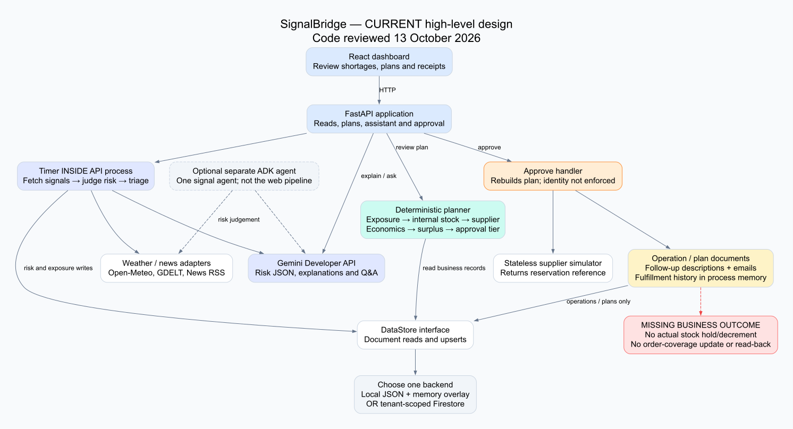
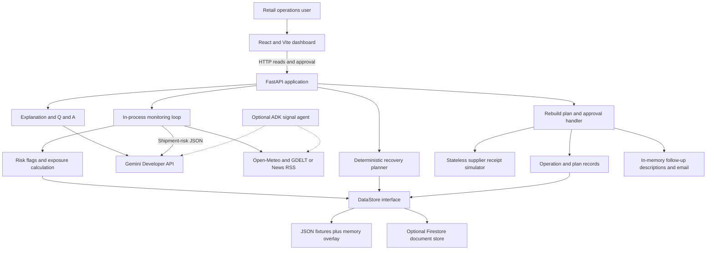
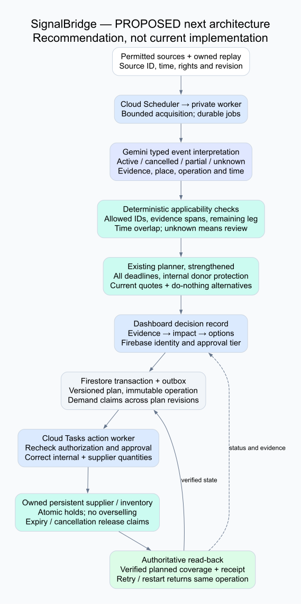
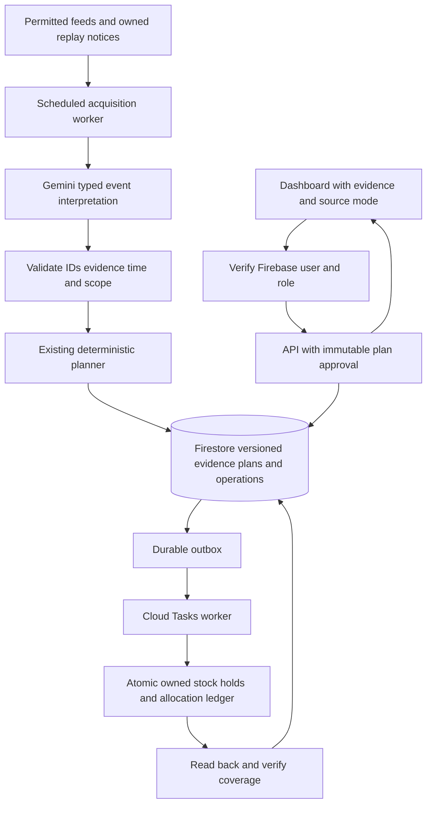

# Current HLD — SignalBridge in simple terms

**HLD means high-level design:** which big parts exist, what each does, and how information moves between them. This is the implementation inspected on 13 October 2026, not the original aspirational blueprint.

## 1. The current flow in one paragraph

The React dashboard calls a FastAPI server. The server reads either local JSON fixtures plus a process-memory overlay, or a tenant-scoped Firestore store. Its background loop fetches weather and news, asks Gemini to judge which shipments might be affected, and writes shipment risk flags and computed exposures. A deterministic planner calculates shortages, looks for internal stock, compares supplier offers, calculates its economic check, predicts surplus, and selects an approval tier. When someone clicks approve, the server rebuilds the plan, asks a stateless supplier simulator for a receipt, saves operation/plan records, builds follow-up descriptions, and optionally sends emails. It currently **does not apply the promised stock or order-coverage changes**.

## 2. The big parts

| Part | What it actually does | Current code |
|---|---|---|
| React/Vite frontend | Dashboard, shipments, threatened orders, recovery modal, recoveries, live signals, capabilities, global Gemini panel | [App](../../../frontend/src/App.jsx), [API client](../../../frontend/src/api.js) |
| FastAPI API | Public routes for views, plans, approval, signals and assistant; no current Firebase identity check | [main](../../../backend/app/main.py), [dependencies](../../../backend/app/deps.py) |
| Process background monitor | An `asyncio` task started with the API; scan runs in a thread while this process exists | [worker](../../../backend/worker/main.py), [lifespan](../../../backend/app/main.py) |
| External adapters | Open-Meteo forecasts; GDELT news with Google News RSS fallback | [weather](../../../backend/adapters/weather.py), [news](../../../backend/adapters/news.py) |
| Gemini integration | Developer API HTTP calls for shipment-risk judgment, explanation and Q&A, with a configured model chain | [Gemini](../../../backend/ai/gemini.py), [config](../../../backend/core/config.py) |
| Deterministic domain | Exposure, own-stock balancing, supplier eligibility, economics, governance, surplus, reservation records and fulfillment descriptions | [planner](../../../backend/domain/planner.py), [domain folder](../../../backend/domain) |
| Data store | Common `list/get/upsert/delete` interface; local overlay or Firestore document operations | [store](../../../backend/core/store.py) |
| Supplier simulator | Generates a random reservation receipt; does not maintain or decrement supplier capacity | [supplier](../../../backend/adapters/supplier.py) |
| Follow-up/email | Creates transfer/PO/order-update descriptions; fulfillment history remains in memory; emails simulated by default | [fulfillment](../../../backend/domain/fulfillment.py), [email](../../../backend/adapters/email.py) |
| Optional ADK agent | One `LlmAgent` using weather/news tools, runnable separately | [agent](../../../backend/agent/agent.py), [tools](../../../backend/agent/tools.py) |

## 3. Current architecture diagram

The ADK agent is outside the normal web/monitor path. Multiple domain modules do not make the implementation a multi-agent orchestrator. There is meaningful AI judgment in monitoring, but the web planner itself is deterministic.

## 4. Three different journeys

### Background monitoring

1. Startup creates `signal_scan_loop` if its interval is positive.
2. Scan configured active ports, sea waypoints and shipment destinations.
3. Fetch weather and news; store signals.
4. Gemini receives shipment/route summaries and selected signal summaries.
5. Apply returned shipment risk decisions and recompute exposures.
6. Build/log recovery plans for actionable exposures.

No Gemini response currently leaves the earlier risk flags unchanged. A partially valid response is more dangerous: omitted shipments can be reset to safe. See the Gemini review for the exact parser behavior.

### Review a recovery

1. The UI fetches `/plans/{sku}/{location_id}`.
2. It independently fetches `/plans/{sku}/{location_id}/explain`.
3. Both endpoints build a plan; only explanation invokes Gemini.
4. The modal presents quantities, options, cost, surplus and approval tier.

These two requests are not pinned to one saved plan snapshot. The staged thinking animation is UI narration, not an execution trace.

### Approve a recovery

1. The UI posts to `/plans/{sku}/{location_id}/approve` without an identity token or plan-version payload.
2. The server recomputes the plan.
3. The simulator returns a receipt.
4. Operation/plan documents are written through the store.
5. Transfer, PO and order-update descriptions are created; emails are prepared/sent; in-memory history is updated.
6. The UI renders completion.

The missing step is the central business outcome: durable, correct supplier/internal holds and updated planned order coverage, followed by read-back.

## 5. What is Google-related today

| Capability | Observed implementation | Limit |
|---|---|---|
| Gemini | Developer API, using an API key and configured model names | No current Cloud Agent Platform inference path verified. |
| ADK | Installed dependency and separate signal agent | Not the automatic monitoring orchestrator. |
| Firestore | Implemented store and seed script | No transactional reservation API in the store; fulfillment history bypasses it. |
| Firebase Hosting | Hosting configuration for frontend build | Configuration is not proof of an accessible deployed submission. |
| Cloud Run | Documented deployment target | No live deployment verified in this review. |
| Scheduler/Cloud Tasks | Discussed in the earlier blueprint | No durable queue or Scheduler-trigger endpoint in the inspected implementation. |
| Google Maps / Search grounding | Not the current map/news implementation | Leaflet/OSM and news feeds are used; do not pitch these as Maps or Search-grounded integrations. |

## 6. Recommended next architecture — explicitly proposed

The smallest strong upgrade keeps the existing domain planner. Add structured, evidence-linked Gemini event interpretation; saved versioned plans; identity-based approval; and a durable sandbox recovery operation that applies actual holds and coverage. Use a task/outbox to recover interrupted work. Put scheduling outside the web process when deploying a background monitor.

In this proposal, AI proposes facts and explains tradeoffs; deterministic code computes and writes. A manager authorizes spending. The simulated supplier owns real persisted sandbox stock, while the UI clearly states that no physical third-party stock was secured.

## 7. Why the background loop needs attention

The current timer runs per API process. Restarts lose its scheduling state; multiple instances can run the same scan; scale-to-zero cannot provide an always-on monitoring promise. The local overlay, operation cache and fulfillment history also belong to a single process.

For the hackathon, either make this limitation visible and provide an explicit replay button, or use an authenticated Scheduler/worker entry point and durable jobs. Do not advertise guaranteed autonomous monitoring based only on a startup task. [Cloud Run background tasks](https://docs.cloud.google.com/run/docs/triggering/using-tasks), [Scheduler to Cloud Run](https://docs.cloud.google.com/run/docs/triggering/using-scheduler).
