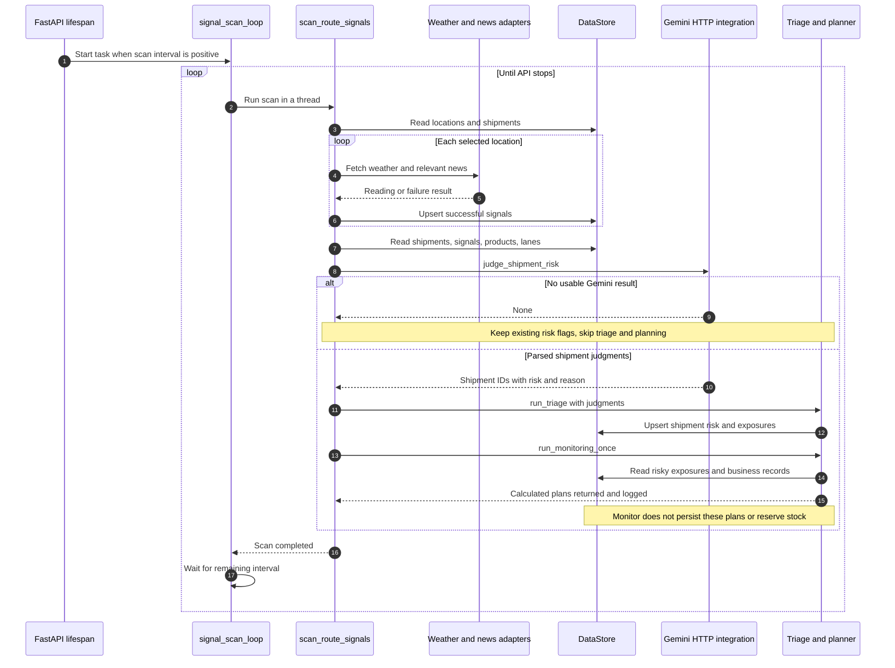
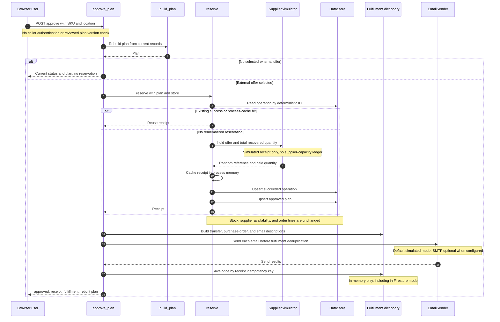
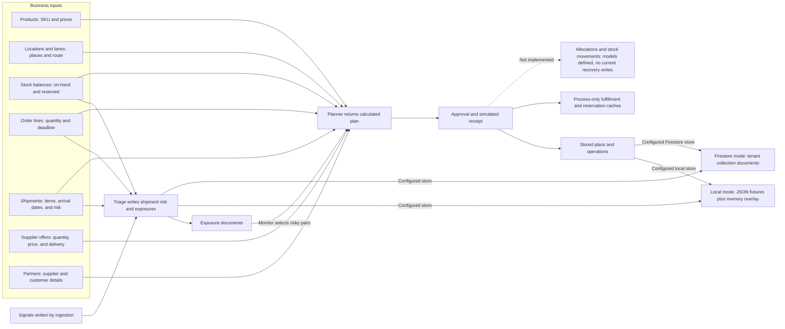

# SignalBridge low-level design: current implementation

This document explains how the checked-in application works, function by function. It describes the current code reviewed on 13 October 2026. **Implemented** means the code performs the action today. **Recommended** means work that is still needed; it must not be presented as an existing feature.

The application currently connects external signals to shipment risk and calculates recovery plans. Approval creates a simulated supplier receipt and descriptive fulfillment records. It **does not yet change inventory, supplier capacity, or customer-order coverage**. That distinction matters when reading the approval response or demonstrating the project.

## 1. Where each responsibility lives

| Area | Current responsibility | Entry point |
|---|---|---|
| React frontend | Show dashboard, shipments, threatened orders, recoveries, signals, and Gemini panels | [App.jsx](../../../frontend/src/App.jsx#L12) |
| Frontend API client | Send browser requests to the configured backend | [api.js](../../../frontend/src/api.js#L23) |
| FastAPI application | Register routes and start the in-process scan loop | [main.py](../../../backend/app/main.py#L12) |
| Configuration | Read environment settings and defaults | [config.py](../../../backend/core/config.py#L21) |
| Store | Read and write either local records or tenant-scoped Firestore documents | [get_store](../../../backend/core/store.py#L207) |
| External adapters | Fetch weather/news; simulate a supplier hold; simulate or send email | [supplier.py](../../../backend/adapters/supplier.py#L13), [email.py](../../../backend/adapters/email.py#L20) |
| Worker | Scan external sources, ask Gemini for risk decisions, and run triage/planning | [scan_route_signals](../../../backend/worker/main.py#L26) |
| Domain functions | Calculate exposure, alternatives, cost, benefit, surplus, and approval tier | [build_plan](../../../backend/domain/planner.py#L84) |
| Gemini integration | Make direct model requests for risk decisions, explanations, and Q&A | [gemini.py](../../../backend/ai/gemini.py#L33) |
| Optional ADK agent | A conversational agent with weather and news tools | [agent.py](../../../backend/agent/agent.py#L19) |

**Implemented:** the monitor calls the Gemini HTTP integration directly. It does not run the ADK agent. The ADK agent currently has two tools, weather and news; it is not the coordinator of the normal scan, plan, or approval path. See [the module's explicit scope](../../../backend/agent/agent.py#L3).

## 2. Startup and configuration

FastAPI's [lifespan function](../../../backend/app/main.py#L12) creates an asynchronous scan task when `SIGNAL_SCAN_INTERVAL_SECONDS` is greater than zero. The loop performs its first pass immediately, runs the blocking scan in a thread, and waits for the remaining interval after the pass. Stopping the API cancels the task. See [signal_scan_loop](../../../backend/worker/main.py#L98).

These are defaults in code, not a claim about any particular machine's `.env` settings:

| Setting | Default | Meaning |
|---|---|---|
| `DATA_BACKEND` | `local` | Read JSON fixtures; keep writes in this process's memory |
| `TENANT_ID` | `buildx-demo` | Select the configured tenant when using Firestore |
| `SIGNAL_SCAN_INTERVAL_SECONDS` | `900` | Target a scan interval of 15 minutes; `0` disables the loop |
| `GOOGLE_API_KEY` | Empty | Gemini calls require a configured key |
| `EMAIL_MODE` | `simulated` | Build and log notifications without transmitting mail |

Sources: [data/model configuration](../../../backend/core/config.py#L21), [scan interval](../../../backend/core/config.py#L50), [email configuration](../../../backend/core/config.py#L77).

**Implemented:** the scan belongs to the running API process. There is no Cloud Scheduler or Pub/Sub call in this path. Multiple API processes would each start their own loop unless deployment/configuration prevents it. A scan interval is not an exact fixed schedule: a long scan can consume the whole interval.

## 3. Monitor: signals to shipment risk to recovery plans

### 3.1 Current sequence



### 3.2 Function steps

1. [signal_scan_location_ids](../../../backend/worker/route_monitor.py#L22) selects known in-transit destinations plus every active port and sea waypoint. It does not restrict all selected ports/waypoints to a shipment's remaining route. These helpers read the shared `get_store()` instance.
2. [scan_route_signals](../../../backend/worker/main.py#L26) reads each selected place, fetches weather if coordinates exist, and fetches news except for `dc` and `dark_store` locations. It delegates storage to the ingestion functions.
3. [ingest_weather_signal](../../../backend/domain/ingestion.py#L35) skips failed readings and writes one latest weather document per place. [ingest_news_signals](../../../backend/domain/ingestion.py#L64) writes one document per article URL.
4. [judge_shipment_risk](../../../backend/ai/gemini.py#L134) prepares active shipments, route names, weather, and recent disruptive headlines. It asks Gemini for JSON decisions, not quantities or a purchase order. [_parse_judgments](../../../backend/ai/gemini.py#L366) keeps known shipment IDs and interprets risk as true only when the returned value is exactly `true`.
5. If Gemini is unavailable or its result cannot be parsed, the worker [returns before triage](../../../backend/worker/main.py#L81). Current risk flags remain unchanged. The worker does not automatically run the domain keyword fallback in this case.
6. [run_triage](../../../backend/domain/triage.py#L187) applies judgments to active shipments, then calculates and stores one exposure per SKU/location. An exposure is marked risky only when a risky shipment coincides with a shortage at the selected deadline.
7. [run_monitoring_once](../../../backend/worker/main.py#L123) reads risky exposures, calls the planner, and returns/logs plans awaiting approval. It does not store plans at this stage.

**Current failure behavior:** a failed weather fetch does not erase a previous weather document, and an unavailable model does not clear old risk flags. Remaining visible records therefore need freshness/status interpretation; they are not proof of a fresh successful scan.

## 4. Exposure and plan calculations

### 4.1 Exposure

[assess_exposure](../../../backend/domain/exposure.py#L85) currently performs:

```text
supply by deadline = on-hand quantity + incoming shipment quantity by deadline
demand by deadline = open order quantity due on or before deadline
shortage           = max(0, demand - supply)
```

[demand_by](../../../backend/domain/exposure.py#L42) ignores non-open orders. [incoming_by](../../../backend/domain/exposure.py#L55) includes planned and in-transit shipments. The planner uses the earliest open-order deadline returned by [_earliest_deadline](../../../backend/domain/planner.py#L23).

**Implemented limitations:** only that earliest deadline is evaluated. Also, when the whole pair is evaluated as disrupted, `incoming_by` uses a stored assumed arrival for any matching shipment that has one, including a safe sibling shipment. Those are correctness gaps, not intended guarantees.

### 4.2 Plan assembly

[build_plan](../../../backend/domain/planner.py#L84) returns a plain dictionary. It reads products, shipments, order lines, balances, locations, offers, partners, lanes, and signals. Its steps are:

| Step | Function or code | Current result |
|---|---|---|
| Select deadline and scenario | [planner.py](../../../backend/domain/planner.py#L101) | Earliest deadline; disrupted if a matching shipment is risky |
| Calculate exposure | [exposure.py](../../../backend/domain/exposure.py#L85) | Demand, supply, shortage, and baseline comparison |
| Find internal stock | [find_internal_surplus](../../../backend/domain/network_balance.py#L27) | Active DC/dark-store stock minus reserved quantity; optional distance |
| Find supplier option | [planner.py](../../../backend/domain/planner.py#L148) | Cheapest single offer meeting remainder, deadline, destination, and blocked-chokepoint checks |
| Assess financial benefit | [assess_margin](../../../backend/domain/margin.py#L8) | Shortage revenue plus penalty minus external recovery cost |
| Estimate surplus | [forecast_surplus](../../../backend/domain/surplus.py#L10) | A simple overlap estimate if the original shipment still arrives |
| Name approval tier | [route_approval](../../../backend/domain/governance.py#L7) | Configured tier and approver metadata |

The cost calculation uses the supplier remainder plus shipping. Internal-transfer cost is not included. The benefit is a revenue-based check, not a full profit calculation. The planner does not enforce the margin verdict as a permission check. Governance names an approver; it does not authenticate one.

Plan status is `no_open_orders`, `no_action_needed`, `awaiting_approval`, or `no_feasible_option`. In the current code, `awaiting_approval` requires a selected external offer, so an all-internal recovery is incorrectly reported as no feasible option. Every newly built plan has `version: 1`; it is not a tracked immutable version history.

## 5. Browser/API contract

The browser's [API wrapper](../../../frontend/src/api.js#L7) sends JSON requests to `VITE_API_BASE`, `window.SIGNALBRIDGE_API`, or `http://localhost:8000`. It does not attach an authentication token. Most routes obtain the store through [store_dep](../../../backend/app/deps.py#L7).

| Method and path | Handler | Current behavior and side effects |
|---|---|---|
| `GET /` | [root](../../../backend/app/main.py#L54) | Service information and help paths |
| `GET /health` | [health](../../../backend/app/routers/health.py#L9) | Backend/tenant information; attempts a Firestore ping in Firestore mode |
| `GET /overview` | [overview](../../../backend/app/routers/dashboard.py#L32) | Derives dashboard totals from shipments and freshly calculated plans |
| `GET /map` | [map_data](../../../backend/app/routers/dashboard.py#L53) | Routes, coordinates, shipment health, and active alerts |
| `GET /incidents` | [list_incidents](../../../backend/app/routers/incidents.py#L13) | Recalculates short SKU/location pairs; one result per pair |
| `GET /plans/{sku}/{location_id}` | [get_plan](../../../backend/app/routers/plans.py#L22) | Builds a current plan; does not fetch an immutable reviewed plan |
| `GET /plans/{sku}/{location_id}/explain` | [explain_plan](../../../backend/app/routers/plans.py#L28) | Builds a plan and calls Gemini or returns local narrative |
| `POST /plans/{sku}/{location_id}/ask` | [ask_plan](../../../backend/app/routers/plans.py#L36) | Accepts `question`; builds plan/context and asks Gemini |
| `POST /plans/{sku}/{location_id}/approve` | [approve_plan](../../../backend/app/routers/plans.py#L47) | Rebuilds plan; gets simulated hold; writes operation/plan; builds fulfillment; sends/simulates notifications |
| `GET /signals/{location_id}` | [get_signals](../../../backend/app/routers/signals.py#L13) | Fetches live weather/news on demand; this handler does not ingest them |
| `POST /assistant/ask` | [ask](../../../backend/app/routers/assistant.py#L26) | Accepts `question` and bounded history; builds network context and calls Gemini |
| `GET /fulfillments` | [list_fulfillments](../../../backend/app/routers/fulfillments.py#L11) | Returns this process's fulfillment dictionary |
| `GET /fulfillments/{operation_id}` | [get_fulfillment](../../../backend/app/routers/fulfillments.py#L18) | Reads a process-local fulfillment record or returns an error object |

Some application errors are JSON bodies returned with HTTP 200, such as unknown locations and missing fulfillments. Consumers must inspect the body; an HTTP success alone does not establish a successful business action. The overview's `orders_at_risk` currently counts short SKU/location plans, not distinct customer orders. See [overview output](../../../backend/app/routers/dashboard.py#L45).

## 6. Approval: what actually happens

### 6.1 Current sequence



### 6.2 Reservation and fulfillment details

[make_idempotency_key](../../../backend/domain/reservations.py#L15) builds a key from SKU, location, selected offer, total recovery quantity, and plan version. [reserve](../../../backend/domain/reservations.py#L28) first looks for a succeeded stored operation, then a global process cache. On a new call it asks the simulator for a hold, caches the receipt, and writes operation and plan documents.

The simulator's [hold function](../../../backend/adapters/supplier.py#L14) creates a reference and a 24-hour expiry. It does not reserve inventory in an owned ledger or call an external supplier. A `verified_at` timestamp in that generated receipt is not an independent verification of stock availability.

[build_fulfillment](../../../backend/domain/fulfillment.py#L21) describes internal transfers, a purchase order for the external remainder, notification content, and an `order_update`. This description is not an inventory/order mutation. [save_fulfillment](../../../backend/domain/fulfillment.py#L94) saves the description and send results in `_FULFILLMENTS`.

**Current quantity mismatch:** the simulator receives the total recovered quantity at [reservations.py:44](../../../backend/domain/reservations.py#L44). Fulfillment's purchase order uses only the supplier remainder at [fulfillment.py:30](../../../backend/domain/fulfillment.py#L30). Those quantities must be reconciled before calling this a verified recovery.

## 7. Data model and persistence

### 7.1 Current relationships



The diagram separates data used for decisions from records actually written. There is deliberately no current approval arrow that updates inventory or order lines.

### 7.2 Store behavior

[DataStore](../../../backend/core/store.py#L25) exposes `list`, `get`, `get_by_id`, `upsert`, and `delete`. It does not expose a transaction, atomic reservation, or conditional version write.

| Store | Read behavior | Write behavior | Lifetime |
|---|---|---|---|
| [LocalStore](../../../backend/core/store.py#L51) | Load fixture JSON and overlay records by natural ID | Put a shallow dictionary copy in `_memory` | One store instance/process; fixture files are not changed |
| [FirestoreStore](../../../backend/core/store.py#L104) | Read tenant documents; list results cached for 15 seconds | Unconditional document `set`, invalidating that collection's local cache | Durable Firestore records; cache remains per process |
| [Fulfillment dictionary](../../../backend/domain/fulfillment.py#L17) | Read `_FULFILLMENTS` | Save once by operation key | One process, regardless of selected store |
| [Reservation fallback cache](../../../backend/domain/reservations.py#L11) | Read `_RESERVATIONS` | Cache a succeeded receipt before store writes | One process; consulted even when a store is supplied |

Firestore paths are `tenants/{tenant_id}/{collection}/{doc_id}`. The configured tenant is not checked against a caller identity. [Document ID rules](../../../backend/models/ids.py#L23) give most collections their natural ID; a stock balance is `location_id__sku`.

Local deletion currently removes only an overlay entry. Deleting a fixture-backed record therefore exposes the fixture again rather than hiding it. See [LocalStore.delete](../../../backend/core/store.py#L98).

### 7.3 Main document shapes

| Record | Important fields | Contract |
|---|---|---|
| Product | SKU, cost, selling price, currency, substitutes | [Product](../../../backend/models/collections.py#L26) |
| Stock balance | SKU/location, on-hand, reserved, incoming, outgoing, version | [StockBalance](../../../backend/models/collections.py#L88) |
| Order line | Line/order/customer, SKU/location, quantity, due date, status, recovery coverage | [OrderLine](../../../backend/models/collections.py#L119) |
| Shipment | ID/lane/destination, item quantities, expected/assumed arrival, risk | [Shipment](../../../backend/models/collections.py#L139) |
| Supplier offer | Available quantity, price, shipping, delivery, expiry, route places | [SupplierOffer](../../../backend/models/collections.py#L161) |
| Signal | Source, URL, publication/fetch times, generic payload | [Signal](../../../backend/models/collections.py#L183) |
| Exposure | SKU/location, supply/demand/shortage, affected lines, risk, computation time | [Exposure](../../../backend/models/collections.py#L237) |
| Plan | Selected offer, internal/recovered quantity, margin, surplus, approval metadata | [Plan](../../../backend/models/collections.py#L268) |
| Operation | Idempotency key, plan version, status, receipt/reservation fields | [Operation](../../../backend/models/collections.py#L294) |
| Allocation and movement | Per-line claims and inventory-change descriptions | [Allocation](../../../backend/models/collections.py#L315), [StockMovement](../../../backend/models/collections.py#L103) |

Money is normally integer minor units plus a currency. `free_to_use` is derived from on-hand minus reserved quantity. Model shapes are validated by [parse_doc](../../../backend/models/collections.py#L341) during [seeding](../../../scripts/seed_firestore.py#L41). Domain store writes currently use plain dictionaries without applying these models. The models do not yet express every business invariant, such as nonnegative quantity or stock consistency.

## 8. Observed correctness gaps and local evidence

The following were reproduced during the local review. The probes used isolated stores, disabled the scan, supplied an empty model key, and replaced email delivery with a fake recorder. They did not call cloud services or SMTP. These observations are additional probes, not new committed tests or a claim that the full test suite covers them.

| Observed behavior | Reproduction result | Source and recommended correction |
|---|---|---|
| No approval authentication | POST without an Authorization header returned `200 approved` for a regional-manager plan | [Route](../../../backend/app/routers/plans.py#L47), [auth TODO](../../../backend/app/deps.py#L12): verify caller and authority |
| No actual recovery state change | Stock, offers, and order-line snapshots were unchanged; actual line coverage stayed zero; rebuilding still said awaiting approval | [Only operation/plan writes](../../../backend/domain/reservations.py#L78), [descriptive order_update](../../../backend/domain/fulfillment.py#L80): reserve capacity and write allocations |
| Wrong external hold quantity | 80-unit recovery included 20 internal; simulator held 80 instead of external remainder 60 | [hold call](../../../backend/domain/reservations.py#L44): persist/use separate allocations |
| Concurrent duplicate supplier action | Two simultaneous identical requests produced two supplier calls and references | [read-then-act](../../../backend/domain/reservations.py#L36): durable operation claim and supplier idempotency |
| Failed persistence hidden on retry | A failed operation write followed by retry returned succeeded while operation and plan collections remained empty | [cache before writes](../../../backend/domain/reservations.py#L55): reconcile pending/durable state |
| Cache reused across store instances | A fresh second LocalStore received the old cached receipt and no operation write | [global cache lookup](../../../backend/domain/reservations.py#L41): do not bypass store persistence |
| Duplicate notifications | Fake send count increased from 2 after one approval to 4 after the second | [send before dedupe](../../../backend/app/routers/plans.py#L64), [save check](../../../backend/domain/fulfillment.py#L97): durable notification/outbox state |
| Later shortage hidden | 100 on-hand, 50 early units, 500 later units returned no action; later deadline had a 450-unit shortage | [earliest deadline](../../../backend/domain/planner.py#L23): evaluate each relevant due-date boundary |
| Safe sibling counted as delayed | Mixed risky/safe shipments counted 0 incoming instead of the safe shipment's 100 | [assumed-arrival selection](../../../backend/domain/exposure.py#L75): choose scenario per shipment |
| Expired offer accepted | Current OFFER-A expired 10 October but was selected in the 13 October probe | [fixture expiry](../../../fixtures/supplier_offers.json#L8), [feasibility](../../../backend/domain/planner.py#L158): inject time and check validity |
| Internal-only recovery blocked | Internal stock covered all 80 units, but status was no feasible option | [external-offer requirement](../../../backend/domain/planner.py#L226), [approval early return](../../../backend/app/routers/plans.py#L57): support internal-only plans |

Other code-level limitations needing explicit treatment:

- [Internal stock selection](../../../backend/domain/network_balance.py#L43) does not validate transfer arrival time, `can_transfer_to`, donor commitments, or transport cost. Distance is informational, not an arrival guarantee.
- [Notification timeline](../../../backend/domain/fulfillment.py#L157) can mark purchase-order email and order coverage done without evidence that those outcomes occurred. [Simulated email](../../../backend/adapters/email.py#L28) reports `sent: true`; the interface should retain the simulation distinction.
- [Fallback triage](../../../backend/domain/triage.py#L47) can match stale or resolved headlines. A 2020 headline saying a strike ended still matched in a local probe. This is not the worker's current no-model branch, which skips triage.
- [Approval](../../../backend/app/routers/plans.py#L56) is not bound to the exact reviewed plan/version/cost. A freshly rebuilt plan can differ from what the user saw.

## 9. Existing tests and useful next checks

**Implemented tests:** [exposure tests](../../../tests/test_exposure.py#L28) cover basic baseline/disrupted shortage; [planner tests](../../../tests/test_planner.py#L20) cover internal-first selection; [route tests](../../../tests/test_planner_routes.py#L29) reject a selected disrupted chokepoint; [store test](../../../tests/test_models_and_store.py#L55) checks operation persistence and a sequential repeat. Tests use the stable small dataset selected in [conftest.py](../../../tests/conftest.py#L10), rather than the expanded current business fixtures.

**Recommended checks before demonstrating verified recovery:** assert supplier remainder and returned hold fields, actual donor/capacity/line updates, simultaneous duplicate calls, retry after a failed write, cross-process fulfillment persistence, notification retries without duplicates, unauthorized/stale approvals, multiple deadlines, safe/risky shipment mixtures, offer expiry, and internal-only recovery.

These recommendations change what the application can prove. They are not implemented behavior in the sequences above. A completed sandbox hold should show its durable capacity change and allocated order coverage; physical receipt of goods should remain a later state.
