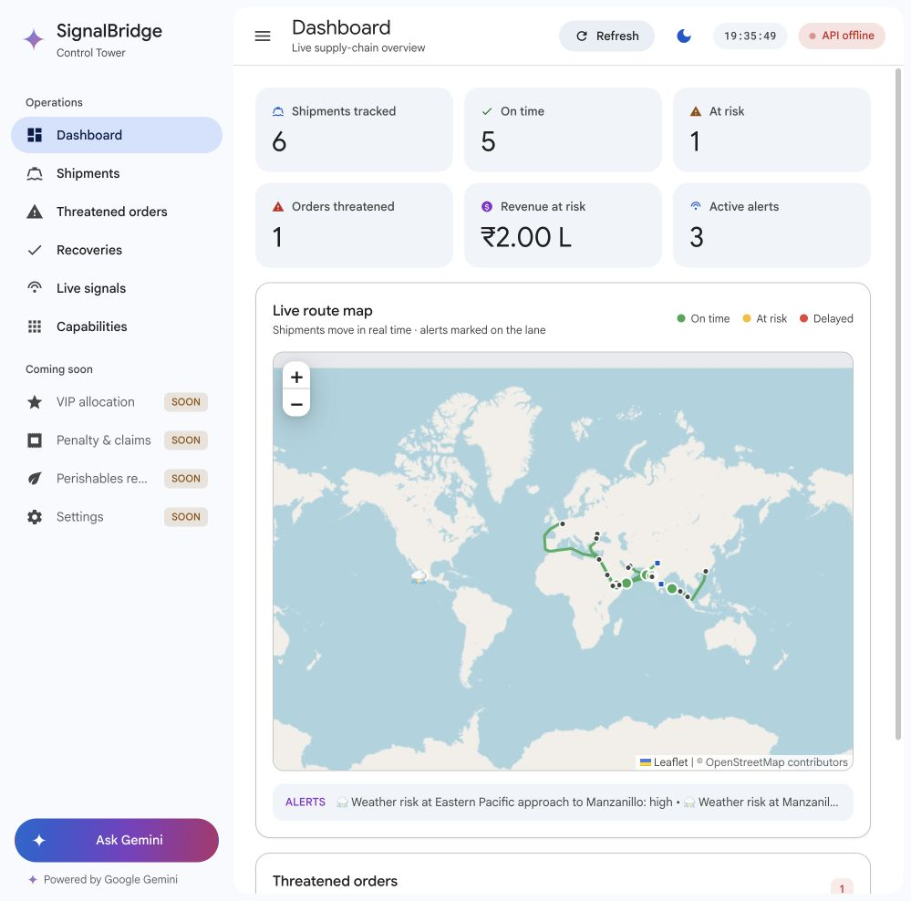
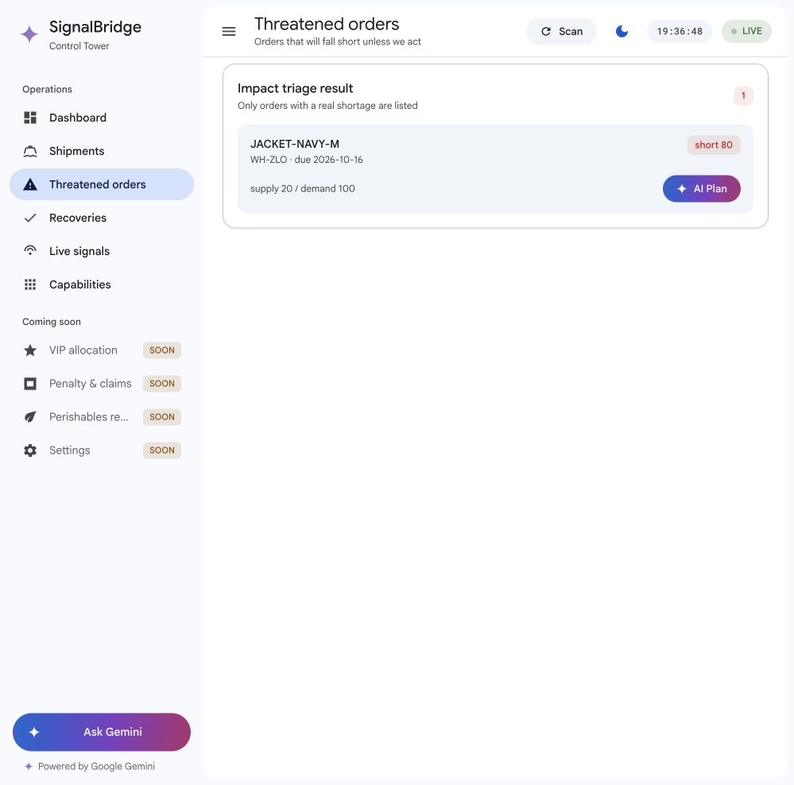
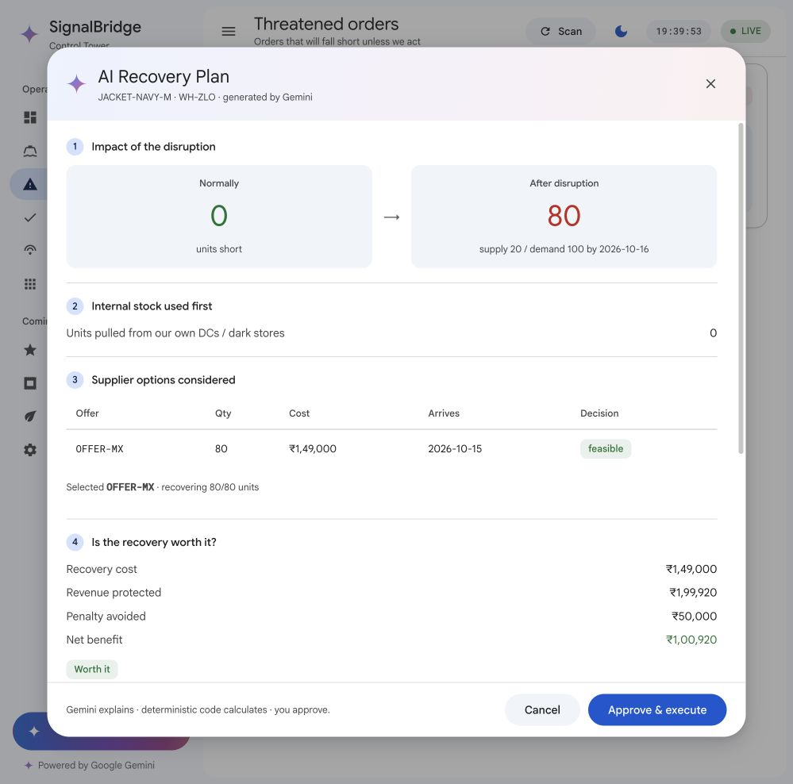
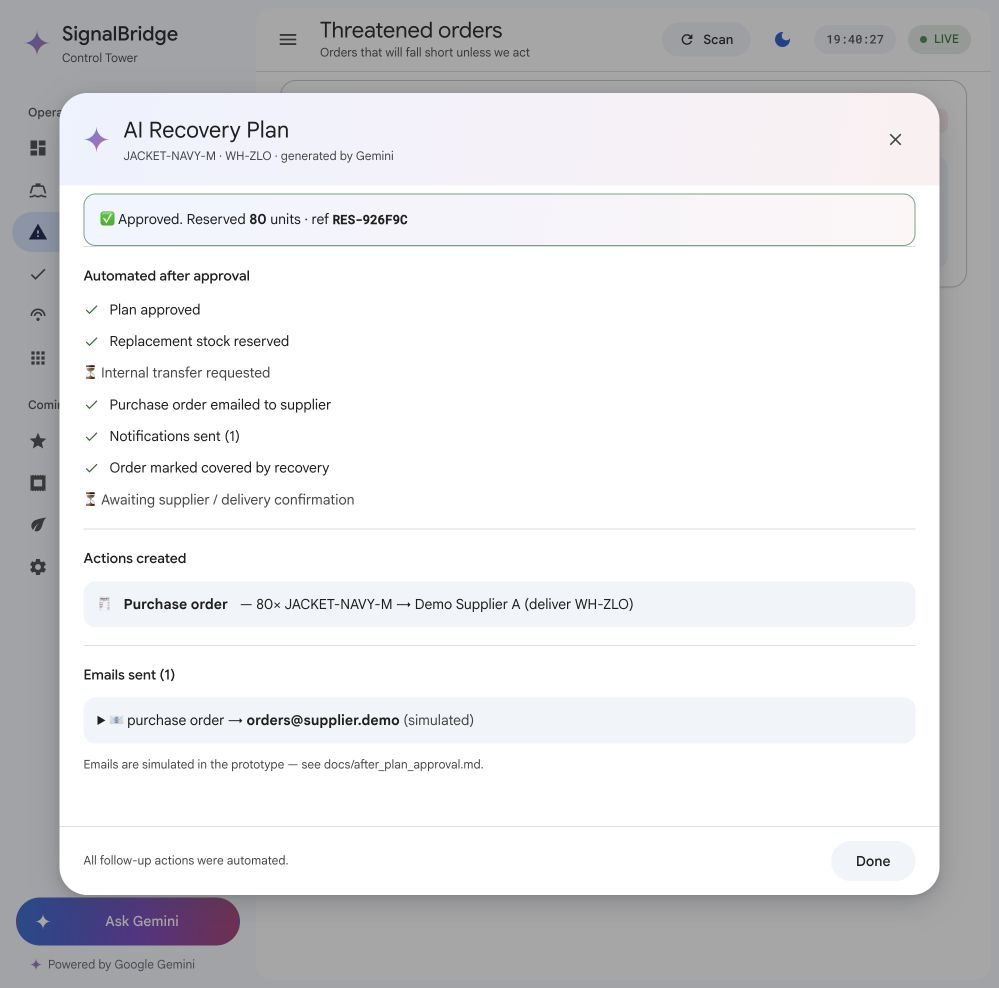

# Current UI walkthrough

Captured in the in-app browser on **13 October 2026**, using the actual local React frontend and FastAPI server. Data mode was local, periodic monitoring and Gemini were disabled, and email mode was simulated. The Mexico jacket shortage comes from the repository's synthetic fixtures. No cloud reservation, model request, physical purchase, or real notification was made.

This is a review of the existing experience, not a redesign. Screenshot numbers correspond to the flow below.

## 1. Dashboard — readable, but the live claims need qualification



**What works:** six clear KPI cards, consistent navigation, route context and alert presence. The captured view showed six shipments, one threatened SKU/location and three weather alerts.

**What needs improvement:** the map dominates the initial viewport while the actionable threatened-order card sits below it. “Shipments move in real time” describes an animated schematic, not carrier telemetry. “Revenue at risk” is calculated from synthetic planning assumptions and should be labeled projected. Synthetic/demo mode and source freshness should be visible here.

**Observed recovery issue:** after the local backend was restarted, Refresh loaded data, but the header still said “API offline.” [Topbar](../../../frontend/src/components/Topbar.jsx#L12) checks health only on mount, so the badge can remain stale. This observation does not establish that the deployed backend is offline.

Two related code findings need distinct states: [Dashboard](../../../frontend/src/pages/Dashboard.jsx#L20) ignores rejected reads and can display “Every order is covered,” while [Incidents](../../../frontend/src/pages/Incidents.jsx#L19) suppresses failures before displaying an empty/safe message. Successful empty results, failed acquisition and stale/unknown results are different. The header also treats HTTP success as LIVE without reading the health body's status; [health](../../../backend/app/routers/health.py#L25) can return degraded with HTTP 200. Add last successful scan, source age and model/fallback mode.

Before public deployment, escape text used in [Leaflet popups](../../../frontend/src/components/MapView.jsx#L100). Stored titles/names are interpolated into HTML and alert titles can come from external news. This is a source-code finding, not a demonstrated runtime exploit; safe React text rendering does not automatically protect a separately built popup HTML string.

## 2. Threatened orders — a clear next step, missing the causal link



**What works:** the shortage quantity, deadline and AI Plan button are easy to find. Navigating to this screen refreshed the mounted health check and showed LIVE.

**What needs improvement:** show product/location names alongside internal IDs, customer order references, and “Why affected?” linking source → event → remaining leg → order. The current list offers a shortage without the evidence needed to justify the disruption assumption. Its grouped SKU/location card is not necessarily one customer order.

**Suggested action:** “Review recovery” accurately describes the deterministic plan; show Gemini's role in interpreting the source separately.

## 3. Recovery plan — strong comparison, inaccurate attribution



**What works:** the 0 → 80 shortage comparison is immediately understandable; supplier quantity, cost, arrival and approval tier appear in a consistent sequence.

**What needs improvement:** the header says “generated by Gemini” even though this audit ran without a model key and the explanation returned a fallback. The four staged thinking labels are timer-driven narration, not a tool trace. Current plan and explanation endpoints independently recompute the plan. The view should display a stable plan/version and real completed stages.

Show the source mode, evidence applicability, quote expiry and original-shipment assumption. Distinguish projected revenue exposure from measured savings. Add deterministic do-nothing and alternative comparisons rather than asking Gemini to calculate money. Only expose approval when the action is feasible and the authenticated user has the required authority.

**Accessibility limits visible or supported by code:** the modal has a labeled close button, but its container lacks dialog semantics and a visible documented focus trap/Escape flow. Table/status badges use text as well as color, which helps. Full contrast ratios, screen-reader behavior, keyboard navigation, mobile layout and conformance were not tested in this review.

## 4. Approval receipt — clear feedback, but completion exceeds backend state



**What works:** reservation reference, follow-up actions and simulated-email disclosure appear together. The timeline distinguishes future delivery confirmation from current progress.

**Critical mismatch:** green ticks claim replacement stock is reserved and the order is marked covered. The current simulator creates only a receipt; the order-update object is descriptive. Immediately after this UI approval, independent reads returned:

```json
{
  "incidents": {"count": 1, "shortage_qty": 80},
  "plan": {"status": "awaiting_approval", "shortage_qty": 80},
  "fulfillments": {"count": 1, "status": "in_progress"}
}
```

These are a condensed representation of three local GET responses, not a new application API contract. The receipt does not prove persisted stock or order coverage. Supplier and inventory mutation must be implemented and read back before this success state is justified.

The timeline also shows “Internal transfer requested” as pending when this scenario uses zero internal units. Display “Not required” for inapplicable steps. The frontend treats a successful HTTP response as completion even when the backend returns a no-action/no-feasible status; render the returned business state explicitly.

## Highest-value UX changes

1. Add an evidence/applicability drawer and a visible synthetic/live/replay label.
2. Pin plan/explanation/approval to one immutable version with quote expiry.
3. Replace generic Gemini attribution and staged narration with truthful source/stage labels.
4. Show verified stock/coverage changes and operation states rather than success-only ticks.
5. Put the threatened action above the map; retain the map as supporting context.
6. Refresh health and authoritative data after action; handle unavailable, pending, rejected and unknown states.

## Evidence limits

All four screenshots were captured during this review and saved without altering their content. The original browser view was inspected, and the saved images were checked before handoff. No live Gemini quality, external news truth, production authentication, carrier integration or physical fulfillment was assessed through these screenshots. Code and separate local read-back, not screenshots alone, establish the backend gaps.
