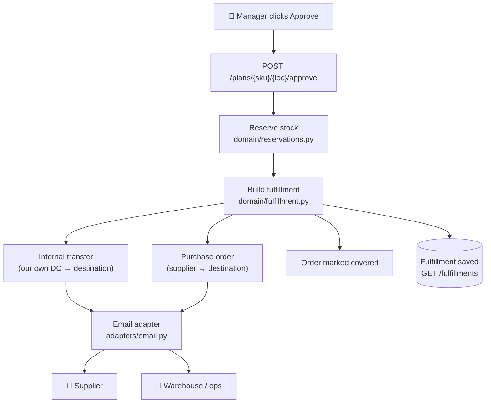

# after_plan_approval.md — What happens after you click Approve

When a manager approves a recovery plan, SignalBridge does **all the follow-up
work automatically** — no one has to raise a purchase order or write an email by
hand. This page explains it simply.

---

## The idea in one line

> **Human approves once → the system reserves the stock, raises the orders,
> emails the supplier and our own warehouse, and marks the order covered.**

A person only makes the *decision*. The computer does the *paperwork*.

---

## What gets automated (in order)

1. **Reserve** the replacement stock (so no one else grabs it).
2. **Create an Internal Transfer** for the units we take from our own stores.
3. **Create a Purchase Order** for the units we buy from a supplier.
4. **Email** the people who must act:
   - the **supplier** gets the purchase order,
   - our **warehouse/ops** team gets the transfer request.
5. **Mark the order "covered by a recovery plan."**
6. Leave one step open: **awaiting delivery confirmation** (a human/real system
   confirms goods actually arrived).

Steps 1–5 happen in **well under a second**, with no clicks.

---

## The flow (architecture)



Who does what:
- **`domain/fulfillment.py`** decides the actions and writes the emails (pure logic).
- **`adapters/email.py`** sends them (or simulates — see below).
- **`routers/plans.py`** glues it together on approve.
- **`routers/fulfillments.py`** lets the UI track the result.

---

## Worked example (the blue jackets)

Plan: cover an **80-unit** shortage of `JACKET-BLUE-M` at `WH-MUM`
(20 from our own Pune dark store, 60 bought from Supplier A).

After approval, the system automatically produces:

| Action | Detail |
|---|---|
| 🔁 Internal transfer | 20 × JACKET-BLUE-M · `DS-PUN-01 → WH-MUM` |
| 🧾 Purchase order | 60 × JACKET-BLUE-M → **Demo Supplier A**, deliver to `WH-MUM`, by 2026-10-15 |
| 📧 Email 1 | to `warehouse-ops@…` (the transfer request) |
| 📧 Email 2 | to `orders@supplier-a.demo` (the purchase order) |
| ✅ Coverage | order marked "covered by recovery plan" |

### The supplier email it writes

```
To: orders@supplier-a.demo
Subject: Urgent Purchase Order: 60 x JACKET-BLUE-M by 2026-10-15

Dear Demo Supplier A,

Please confirm the following emergency replenishment order:

  Product    : JACKET-BLUE-M
  Quantity   : 60 units
  Deliver to : WH-MUM
  Unit price : Rs 1,800
  Required by: 2026-10-15
  Our ref    : RES-1200E0

This covers a shortage caused by a transit disruption. Please reply
to confirm availability and dispatch.

Regards,
SignalBridge Operations
```

On the dashboard, after you click **Approve & reserve**, you see this timeline,
the two actions, and the emails (click to expand) — and the route turns **green**
on the map.

---

## Sending real email (optional)

By default emails are **simulated** — built and logged, but not actually sent. No
setup, no secrets, safe for demos.

To send for real, set these in `.env` (never commit them):

```
EMAIL_MODE=smtp
EMAIL_FROM=ops@yourcompany.com
SMTP_HOST=smtp.gmail.com
SMTP_PORT=587
SMTP_USER=your-address@gmail.com
SMTP_PASSWORD=your-app-password        # a Gmail App Password, not your login
OPS_EMAIL=warehouse@yourcompany.com
DEFAULT_SUPPLIER_EMAIL=orders@supplier.com
```

The code path is already there (`adapters/email.py`); it only switches on when
`EMAIL_MODE=smtp`. A later, nicer option is **SendGrid/Gmail API** instead of raw
SMTP — see [manual_work.md](manual_work.md).

---

## The endpoints

| Call | What it does |
|---|---|
| `POST /plans/{sku}/{location}/approve` | Approve → reserve → PO + transfer → emails → covered |
| `GET /fulfillments` | List every approved recovery and its status |
| `GET /fulfillments/{operation_id}` | One fulfillment (actions, emails, timeline) |

Try it:

```bash
curl -X POST http://localhost:8000/plans/JACKET-BLUE-M/WH-MUM/approve
curl http://localhost:8000/fulfillments
```

---

## Safe by design

- **Idempotent:** approving the same plan twice does **not** buy twice. The
  reservation and fulfillment are keyed by a stable operation id; a repeat returns
  the existing result.
- **Email never breaks approval:** if SMTP fails, approval still succeeds and the
  failure is recorded.
- **"Covered" ≠ "delivered":** the order is marked covered by a *plan*. Real
  delivery is the last, still-manual step.

---

## What's live vs coming soon

| Piece | Status |
|---|---|
| Reserve + PO + transfer + emails + coverage | ✅ Live (automated) |
| Simulated email | ✅ Live |
| Real SMTP email | ✅ Ready (set env vars) |
| Delivery-confirmation webhook (supplier replies → auto-close) | 🔜 Coming soon |
| Write-back to Firestore + audit log | 🔜 Coming soon |
| Auto penalty/insurance claim if supplier misses the deadline | 🔜 Coming soon |
