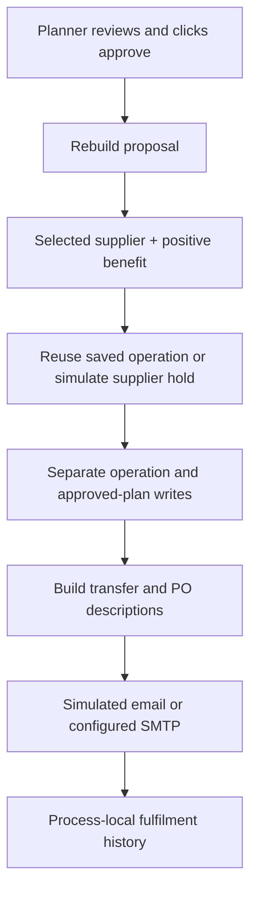

# Approval and follow-up workflow

A planner reviews the calculated proposal, source evidence and assumptions before selecting **Approve & execute**. The current application demonstrates a controlled workflow with a simulated supplier, not a completed physical purchase or inventory transfer.

## Current sequence

`POST /plans/{sku}/{location_id}/approve` in [plans.py](../backend/app/routers/plans.py):

1. Rebuilds the proposal from current store reads.
2. Returns without approving if there is no selected external offer.
3. Rejects a non-positive configured recovery-benefit verdict with HTTP 409.
4. Calls [reserve](../backend/domain/reservations.py) for the external supplier quantity only.
5. Saves operation and approved-plan records through the configured store.
6. Builds internal-transfer and purchase-order descriptions through [fulfilment code](../backend/domain/fulfillment.py).
7. Sends or simulates the generated email requests.
8. Saves the fulfilment response/timeline in process memory.

The UI enables approval for an awaiting-approval plan with a selected offer and positive verdict. Approval tiers identify the intended approver, but backend user authentication and role enforcement are still planned.



This flow is not a distributed transaction or an exactly-once execution guarantee.

## What is real, simulated or only described

| Result | Current meaning |
|---|---|
| Supplier receipt | Generated by `SupplierSimulator`. It does not contact a supplier, verify availability or decrement capacity. |
| Supplier quantity | Total recovered quantity minus internal quantity. Only this external amount is sent to the simulator. |
| Operation and approved plan | Persist through Firestore when configured, or local memory overlay in local mode. |
| Internal transfer / purchase order | Structured action descriptions and email content. Not an ERP-confirmed transfer/purchase. |
| Order update | A fulfilment response description, not a write to `order_lines.recovery_coverage_qty`. |
| Dashboard coverage | Approved SKU/location pairs are omitted from threatened lists. This is not physical fulfilment or allocated-stock proof. |
| Fulfilment timeline | In-memory history, lost on restart and not shared across instances. |
| Delivery confirmation | Not integrated. |

No current approval transaction updates stock balances, stock movements and allocation claims together. Internal-only approval is not supported because the endpoint expects a selected supplier offer.

## Retry and failure boundaries

A sequential retry can reuse an existing succeeded reservation operation. However:

- The initial read, supplier call and document writes are not atomic.
- Version fields do not provide universal concurrency control.
- A partial failure can leave operation and plan records inconsistent.
- Emails are attempted before the in-memory fulfilment deduplication. Repeating approval can resend them.
- A real supplier timeout would need a supplier-side idempotency contract; the simulator does not establish it.

Do not promise no double-booking or exactly-once notifications until concurrent/retry/restart tests and durable controls exist.

SMTP failures return an error result rather than rolling back approval. The UI timeline is a workflow description, not independent delivery evidence. No sub-second approval SLA is established.

## Optional SMTP

Default `EMAIL_MODE=simulated` logs/builds email without transmitting it. The simulated result can contain `sent=True`; inspect `mode`, not that flag alone, before calling it delivered.

To intentionally enable real mail, configure local/deployment secrets:

```dotenv
EMAIL_MODE=smtp
EMAIL_FROM=ops@example.com
SMTP_HOST=smtp.example.com
SMTP_PORT=587
SMTP_USER=your-smtp-user
SMTP_PASSWORD=your-smtp-secret
OPS_EMAIL=warehouse@example.com
DEFAULT_SUPPLIER_EMAIL=orders@example.com
```

Do not use real recipients for unattended tests. Keep credentials out of Git and logs. SMTP acceptance is not proof that a person received or acted on a message.

## Read endpoints

- `GET /fulfillments`
- `GET /fulfillments/{operation_id}`

The fulfilment identifier currently uses the receipt's idempotency key, whereas the persisted operation document has its own `OP-...` ID. Use the identifier returned by that endpoint rather than assuming they are identical.

## Next steps

Authenticated approvals, donor-safe/internal-only transfers, transactional inventory allocation, durable fulfilment, a notification outbox and delivery confirmation are detailed in the [roadmap](roadmap.md). They do not require replacing the current planning architecture.
