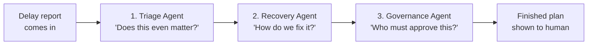
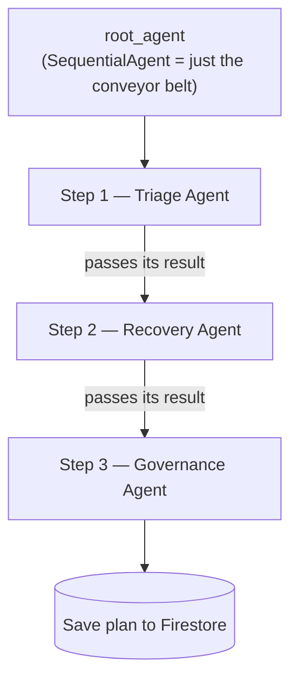

# details.md — What each agent does, in simple words

This file explains the **"How the agent is wired (ADK)"** part of [blueprint.md](blueprint.md) in the simplest possible way.

If that diagram felt confusing, read this file first. No prior ADK knowledge needed.

---

## 1. Three words you must know first

Everything below is built from only these three ideas.

| Word | Think of it as | In our project |
|---|---|---|
| **Agent** | An **employee** who can think and decide | A Gemini-powered worker with one specific job |
| **Tool** | A **button the employee is allowed to press** | A normal Python function (e.g. "calculate shortage") |
| **ADK** | The **office manager** that makes employees work in order | Google's Agent Development Kit — the library that runs our agents |

> An agent **cannot** do anything by itself. It can only *think* and *press the buttons (tools) we gave it*. That is the whole safety model.

---

## 2. The one-line big picture

> A shipment is delayed → **3 agents** look at it one after another → they produce **one recovery plan** → a human approves it → the system books the replacement stock.

That's it. Everything else is detail.

---

## 3. Meet the team (our 3 agents)

Imagine a small 3-person team sitting in a supply-chain office. A delay report lands on the first person's desk, and it moves down the line.



---

### Agent 1 — Triage Agent 🔍 *"Does this even matter?"*

**The problem it solves:** Every day there are *thousands* of delays, storms, strikes and port notices. 99% of them do not hurt us. A human cannot read all of them.

**Its one job:** Throw away the noise. Keep only the delays that will cause a **real stockout** or a **penalty**.

| | |
|---|---|
| **Gets** | Raw news / port notices + our list of active shipments |
| **Does** | Reads the messy text, pulls out *what happened, where, when*, then checks: does this actually touch one of our shipments? |
| **Gives** | A short list: "These 2 shipments are genuinely in danger." |
| **Tool it presses** | `exposure_tool` → tells it how many units we are actually short |
| **Why Gemini is needed** | News is written in free, messy human language. Normal code cannot read *"operations at the terminal remain suspended until further notice."* Gemini can. |

**Example:** 50 news items come in. 49 are irrelevant (wrong port, old incident, different country). Agent 1 passes **1** forward.

---

### Agent 2 — Recovery Agent 🛠️ *"How do we fix it?"*

**The problem it solves:** Knowing you'll be short 80 jackets is useless. You need the *best* way to get 80 jackets.

**Its one job:** Build the actual rescue plan — and make sure the cure isn't worse than the disease.

It presses its buttons in a smart order:

| Step | Tool it presses | The question it answers |
|---|---|---|
| 1 | `network_balance_tool` | "Do **we** already have these units in another warehouse or dark store?" *(free — always check first)* |
| 2 | `supplier_tool` | "If not, who can sell them to us, how many, by when, at what price?" |
| 3 | `margin_tool` | "Does this fix cost more than the profit we're saving?" *(if yes → reject it)* |
| 4 | `surplus_tool` | "When the late shipment finally arrives, will we be stuck with extra stock?" |

| | |
|---|---|
| **Gets** | The shortlist from Agent 1 |
| **Gives** | One recommended option + the rejected ones + a plain-English reason for each |
| **Why Gemini is needed** | There are many valid options. Gemini **compares trade-offs and writes the explanation** a manager can actually read. |

> ⚠️ Important: Gemini **does not calculate the money**. It asks the tool, and the tool does the math in normal Python. Gemini only *chooses and explains*.

---

### Agent 3 — Governance Agent 🧑‍⚖️ *"Who is allowed to say yes?"*

**The problem it solves:** A ₹5,000 fix shouldn't wait for the CFO. A ₹50,00,000 fix must **never** be auto-approved.

**Its one job:** Decide which human gets the approval request.

| Plan value | Routed to |
|---|---|
| Small | Local planner |
| Medium | Regional manager |
| Large | Executive sign-off |

| | |
|---|---|
| **Gets** | The finished plan from Agent 2 |
| **Gives** | The same plan, stamped with `approval_tier` + who must sign |
| **Then** | Saves it to Firestore → it appears on the dashboard |

> The agent **never approves anything itself**. It only decides *whose inbox it lands in*. A human always presses the final button.

---

## 4. So what is the "root agent"?

The root agent is **not** a fourth thinker. It is just the **conveyor belt**.

In ADK it's a `SequentialAgent`, which means exactly one thing:

> "Run Agent 1. Then give its output to Agent 2. Then give that to Agent 3."

That's the entire job. Simple hand-off, in order.



**Why split into 3 instead of one big agent?** Three reasons:
1. One agent with 10 jobs gets confused and hallucinates. Three agents with 1 job each stay accurate.
2. You can test and fix each one separately.
3. When a judge asks *"what does your AI actually do?"* — you have 3 clear answers.

---

## 5. What is a "tool", really?

This is the part people usually get stuck on. A tool is **just a normal Python function**. Nothing magic.

```python
def exposure_tool(sku: str, warehouse_id: str, due_date: str) -> dict:
    """Returns how many units we will be short of for this SKU by the due date."""
    return calculate_exposure(sku, warehouse_id, due_date)   # plain math in domain/
```

Two things make it usable by an agent:
- **Type hints** (`sku: str`) → so the agent knows what to pass in.
- **The docstring** → ADK shows this line to Gemini, and Gemini reads it to decide *"ah, this is the function I need right now."*

So the docstring is not a comment for humans. **It is the instruction the AI reads.** Write it clearly.

---

## 6. The golden rule: who does what

This is the single most important idea in our whole design.

| Job | Who does it | Why |
|---|---|---|
| Read messy news text | 🤖 **Gemini** | Only AI can understand free-form human language |
| Decide if it's relevant | 🤖 **Gemini** | Needs judgement |
| Compare options & explain | 🤖 **Gemini** | Needs reasoning + writing |
| **Calculate numbers** | 💻 **Normal Python** (`domain/`) | Must be 100% correct, every single time |
| **Write to the database** | 💻 **Normal Python** (`domain/`) | Must be safe and happen exactly once |
| **Final approval** | 🧑 **Human** | Money is involved |

> **Say this in your demo:** *"Gemini decides and explains. Deterministic code does the math and the writes. A human approves the money."*
>
> Judges love this, because an AI that invents stock numbers is a broken product.

---

## 7. One full story, with real numbers

Follow our jacket example all the way through:

| # | Who | What happens |
|---|---|---|
| 1 | ⏰ Cloud Scheduler | Wakes the worker up (every 30 min) |
| 2 | 👷 Worker | Reads active shipments, fetches news, starts the root agent |
| 3 | 🔍 **Triage Agent** | Reads a port suspension notice → it hits shipment `SHP-001` (500 jackets) |
| 4 | 🔍 → `exposure_tool` | We have 120, we owe 200 by 16 Oct → **short 80 units** ✅ real problem |
| 5 | 🛠️ **Recovery Agent** → `network_balance_tool` | Any of our own warehouses have spare? → No |
| 6 | 🛠️ → `supplier_tool` | Supplier A: 90 units, arrives 15 Oct ✅ · Supplier B: only 30 ❌ · Supplier C: arrives 20 Oct ❌ too late |
| 7 | 🛠️ → `margin_tool` | Cost = ₹1,49,000. Is the order's margin bigger? → ✅ worth it |
| 8 | 🛠️ → `surplus_tool` | The late 500 will still arrive → ⚠️ flag future overstock |
| 9 | 🧑‍⚖️ **Governance Agent** | ₹1.49L = medium → route to **Regional Manager** |
| 10 | 💾 Firestore | Plan saved → appears on dashboard |
| 11 | 🧑 **Human** | Reads evidence + reason → clicks **Approve** |
| 12 | 💻 `reservation_tool` | Books 80 units **once**, reads it back to confirm ✅ |
| 13 | 📊 Dashboard | "80 units secured. Order protected." |

Steps 3–9 happen with no human at all. The human only appears at step 11, with everything already explained.

---

## 8. Confusions cleared up

**"Are the 3 agents 3 separate servers?"**
No. They are 3 Python objects inside one package, running in one Cloud Run service.

**"Does the agent talk to Firestore directly?"**
No. It calls a tool, and the tool talks to Firestore. The agent never touches the database.

**"Can the AI buy stock on its own?"**
No. Agents only *propose*. Booking happens after a human clicks approve, in `domain/reservations.py`.

**"What if Gemini makes something up?"**
It can only act through our tools, and tools reject bad input. It cannot invent a supplier, a price, or a quantity — those come from the database.

**"Where do I start coding?"**
Start with `domain/exposure.py` (pure math + a test). No AI needed. Add the agent once the math is proven correct.

---

## 9. Thirty-second summary

- **3 agents**, each with **one job**: *is it serious?* → *how do we fix it?* → *who signs off?*
- **root_agent** just runs them in order. It doesn't think.
- **Tools** are plain Python functions; their docstring is what the AI reads.
- **Gemini reasons and explains. Python calculates and writes. A human approves.**
