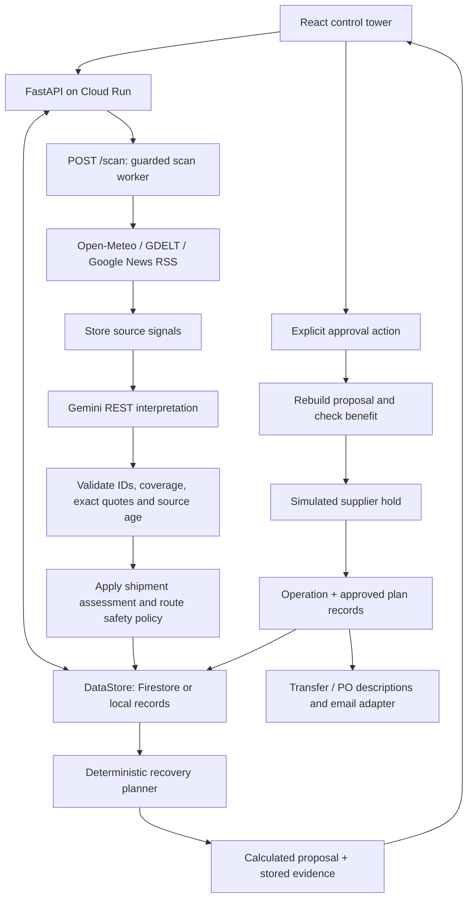

# SignalBridge architecture

SignalBridge connects external disruption evidence to a retail recovery decision. A notice becomes useful only after its relevance to a shipment and its impact on an order deadline are understood.

## Current components

| Component | Responsibility | Implementation |
|---|---|---|
| React/Vite frontend | Dashboard, shipments, threatened orders, recoveries, live signals, decision walkthrough, capabilities and Gemini panels. | [App](../frontend/src/App.jsx), [API client](../frontend/src/api.js) |
| FastAPI application | Reads, planning, evidence briefs, scan triggers, chat and approval endpoints. Serves the built frontend when present. | [Application](../backend/app/main.py), [routes](../backend/app/routers) |
| Scan worker | Fetches external signals, invokes Gemini, applies validated assessments and computes exposures. Builds/logs recovery proposals after successful triage. | [Worker](../backend/worker/main.py) |
| Gemini REST integration | Structured shipment interpretation, plan explanations, network-wide and per-plan questions. | [Gemini](../backend/ai/gemini.py) |
| Deterministic domain | Exposure, internal availability, supplier feasibility, cost, benefit, surplus estimate and approval tier. No model calls. | [Planner](../backend/domain/planner.py) |
| Store abstraction | Local fixtures plus a memory overlay, isolated snapshots, or tenant-scoped Firestore. | [Stores](../backend/core/store.py) |
| Execution adapters | Simulated supplier receipt and simulated-by-default email. Transfer/PO descriptions are assembled in Python. | [Approval details](after_plan_approval.md) |

## Main application flow

Gemini calls and deterministic functions run within one application workflow, not a two- or three-agent ADK pipeline. The diagram is a logical flow, not an atomic transaction.

### Monitoring sequence

1. The operational frontend requests `POST /scan` on load/refresh.
2. A per-process guard prevents overlapping scans and throttles recent scans, normally for 600 seconds.
3. The worker scans in-transit destinations plus all active ports and sea waypoints. This discovery set is broader than the precise routes later used for interpretation.
4. Successful readings are saved as signals. Gemini assesses active (`in_transit` or `planned`) shipments against supplied evidence and route records.
5. Valid results update shipment assessments and exposures. A severe-route policy can override an unaffected interpretation, with its evidence shown separately.
6. An unavailable/invalid batch preserves earlier risk flags and evidence, records the failed attempt and skips that scan's triage/planning update.

The timer defaults to disabled. Cloud Run's scan endpoint runs the scan inline; local execution can use a thread. See [monitoring](scheduler.md).

### Planning and evidence

The API calculates a plan for a SKU/location pair, using its earliest open-order deadline. A brief materializes a private read snapshot and uses one calculation clock for its plan and evidence view. This snapshot is not a Firestore cross-collection transaction.

Plans are calculated on request. The worker builds/logs proposals but does not persist every generated candidate. Approval saves the selected plan and operation. Exact persistence behavior is in the [data contract](schema.md).

## Google product roles

| Product | Role | Status |
|---|---|---|
| Gemini API | Evidence interpretation, explanations and questions via API-key REST calls. | Implemented main AI path |
| Cloud Run | Combined FastAPI and built React application container. | Deployment runtime |
| Cloud Firestore | Operational records, signals, assessments, exposures, approved plans and operations. | Implemented store |
| Cloud Build | Build the container for the deployment workflow. | Deployment infrastructure |
| Artifact Registry | Store the image deployed to Cloud Run. | Deployment infrastructure |
| Google ADK | One separately runnable weather/news agent. | Optional, not web orchestration |
| Firebase Hosting | Separately host `frontend/dist` with a configured API base. | Optional configuration |
| Google News RSS | News fallback when GDELT fails. | Implemented external source |
| Cloud Scheduler | Authenticated unattended scan trigger. | Planned |

The current AI integration is not Vertex AI or Agent Engine. Firebase Auth, Cloud Tasks, Document AI, BigQuery, Maps and FCM are not required active components. Do not add them to the current diagram solely because they are possible future integrations.

## Important boundaries

- AI interprets evidence; code owns authoritative quantities and money.
- Arrival delays are stored assumptions, not Gemini-predicted ETAs.
- Internal stock is on-hand minus reserved, not a complete donor-safe transfer model.
- Supplier execution is simulated. Approval records do not establish physical delivery or stock ledger changes.
- Approval tiers are calculated, but caller identity/role enforcement is not implemented.
- Store writes are separate document operations. There is no complete transactional allocation or exactly-once notification workflow.
- Fulfilment history is process-local, even when plan/operation records use Firestore.

See [calculations](calculation.md), [approval](after_plan_approval.md) and [roadmap](roadmap.md).
