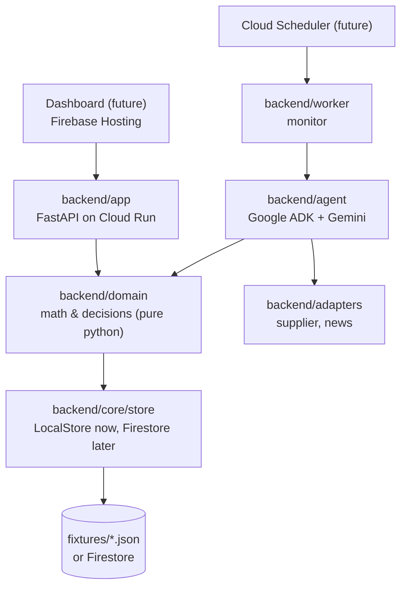
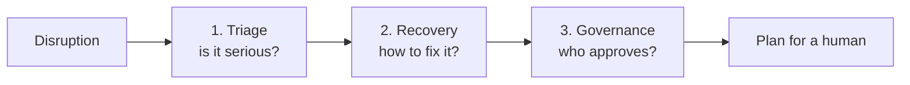
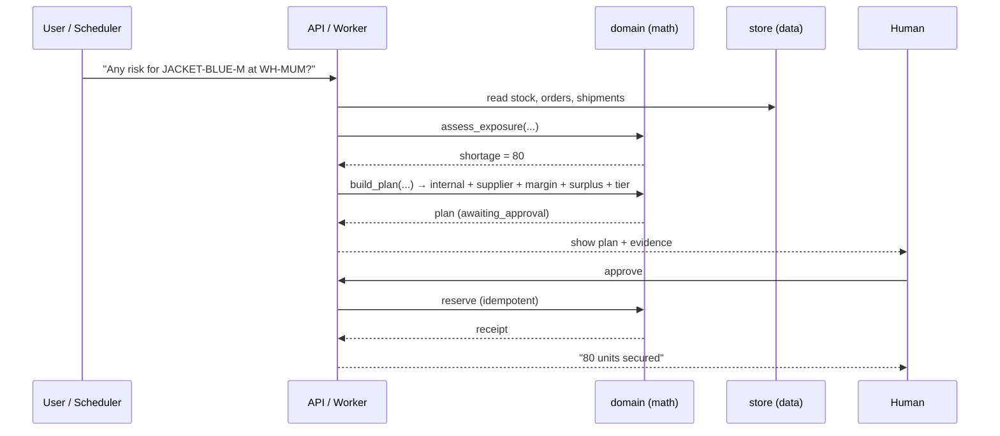

# architecture.md — The big picture

SignalBridge turns a **supply-chain disruption** into a **traceable recovery
plan** that a human approves. This page shows how the code is organised and how a
request flows through it.

For deeper reading:
- [agents.md](agents.md) — what each AI agent does, in plain words
- [schema.md](schema.md) — the data model
- [blueprint.md](blueprint.md) — the full original design (with more diagrams)

---

## The one-line idea

> A port delay doesn't change how much stock we *have* — it changes whether
> incoming stock arrives **in time**. SignalBridge spots the resulting shortage,
> finds the cheapest safe way to cover it, and asks a human to approve.

---

## The layers

| Folder | Job | Needs cloud? |
|---|---|---|
| `backend/domain` | The math and the decisions. **Pure python, fully tested.** | No |
| `backend/core` | Config, the data store, logging | No |
| `backend/adapters` | Talk to suppliers / news (fakes for now) | No |
| `backend/agent` | The Gemini agent that reasons and explains | Needs a key |
| `backend/app` | The web API (read data, approve plans) | No (reads) |
| `backend/worker` | The background monitor | No |

**Golden rule:** the **agent reasons and explains**; **domain code does the math
and the writes**; a **human approves** anything that costs money.

---

## The three agents

The agent is a small team of three, run one after another. Full explanation in
[agents.md](agents.md).

Each agent only calls a few **tools** (plain functions in `backend/agent/tools.py`),
and those tools call the deterministic code in `backend/domain`.

---

## One request, end to end

---

## The five capabilities → where they live

| Capability | Code |
|---|---|
| Impact Triage (filter noise) | `backend/domain/exposure.py` |
| Margin Optimization | `backend/domain/margin.py` |
| Internal Network Balancing | `backend/domain/network_balance.py` |
| Multi-Tier Governance | `backend/domain/governance.py` |
| Predictive Surplus | `backend/domain/surplus.py` |
| (glued together) | `backend/domain/planner.py` |

---

## Why local-first?

The whole project runs on JSON fixtures with **no cloud account**. That means:
- anyone can clone it and see it work in 2 minutes,
- tests run instantly in CI with no secrets,
- we swap `LocalStore` → `FirestoreStore` in **one place** when we're ready.

See [start.md](start.md) to run it, and [manual_work.md](manual_work.md) for the
cloud steps.
