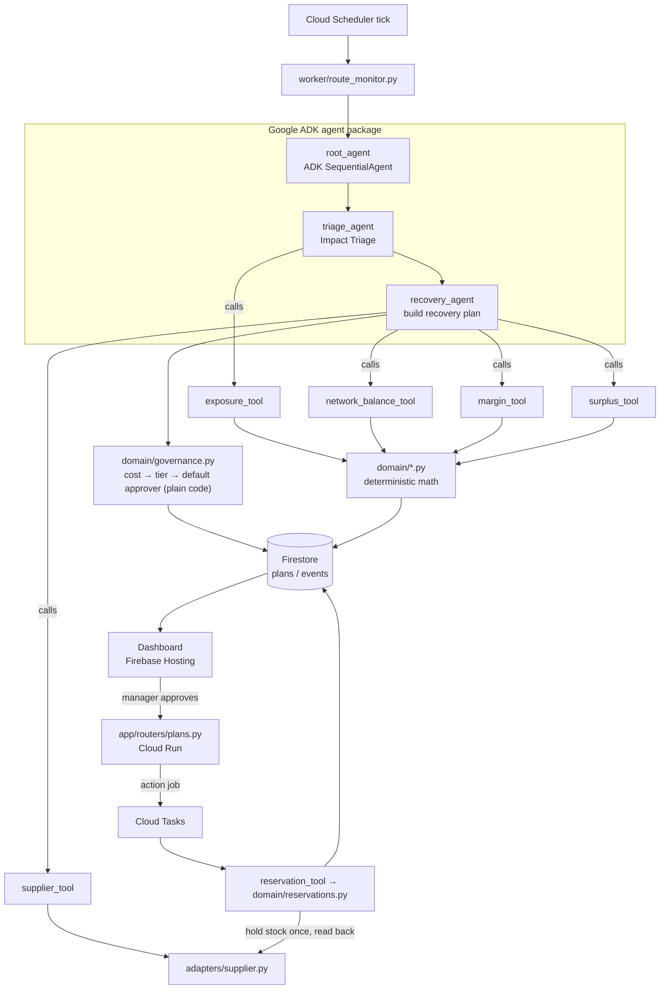
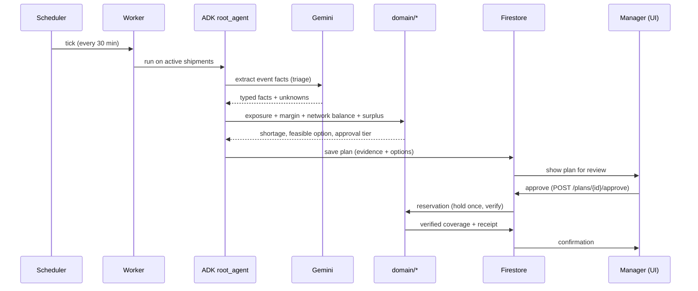

# SignalBridge — Code Base Init Blueprint

**Simple starter structure for the build.** Theme: *Retail & Commerce*. Stack: **Google ADK + Gemini on Google Cloud**, deployed on **Cloud Run + Firebase**.

Goal of this doc: show *where every piece of code lives* and *how the agent is wired*, so anyone on the team can clone the repo and know exactly where to add their part. Nothing here is implemented yet — it is the skeleton.

---

## 1. The 5 core capabilities → where they live

| Capability | Plain meaning | Lives in |
|---|---|---|
| Automated Impact Triage | Keep only the shipments that will actually cause a stockout / OTIF penalty | `agent/sub_agents/triage_agent.py` + `domain/exposure.py` |
| Dynamic Margin Optimization | Don't spend ₹100 to save ₹60 of margin | `domain/margin.py` (called via `tools/margin_tool.py`) |
| Internal Network Balancing | Check our own DCs / dark stores before buying outside | `domain/network_balance.py` (via `tools/network_balance_tool.py`) |
| Multi-Tier Governance | Small fix → local planner; big spend → executive sign-off (plain rules, a default approver per tier) | `domain/governance.py` |
| Predictive Surplus Management | Flag future overstock when the late shipment finally arrives | `domain/surplus.py` (via `tools/surplus_tool.py`) |

> Rule of thumb: **Gemini/ADK decides and explains; `domain/` code does the math and the writes.** Numbers and reservations are never left to the model.

---

## 2. Folder structure

```text
signalbridge/
├── README.md
├── .env.example               # GOOGLE_API_KEY / project id / region (never commit real keys)
├── pyproject.toml             # google-adk, google-cloud-firestore, fastapi, pydantic
├── Makefile                   # make run-api / run-worker / seed / test / deploy
│
├── backend/
│   ├── app/                   # Application API  →  Cloud Run (FastAPI)
│   │   ├── main.py            # app entrypoint, CORS, auth middleware
│   │   ├── deps.py            # Firebase Auth check, tenant resolver
│   │   └── routers/
│   │       ├── incidents.py   # GET incidents / exposure for the dashboard
│   │       ├── plans.py       # GET a plan, POST approval (human-in-the-loop)
│   │       └── health.py
│   │
│   ├── agent/                 # Google ADK agent package  (the "brain")
│   │   ├── __init__.py
│   │   ├── agent.py           # root_agent — the coordinator (SequentialAgent)
│   │   ├── sub_agents/
│   │   │   ├── triage_agent.py      # Impact Triage  (LlmAgent)
│   │   │   └── recovery_agent.py    # builds the recovery plan (LlmAgent + tools)
│   │   ├── tools/             # typed functions the agents are allowed to call
│   │   │   ├── exposure_tool.py
│   │   │   ├── margin_tool.py
│   │   │   ├── network_balance_tool.py
│   │   │   ├── surplus_tool.py
│   │   │   ├── supplier_tool.py
│   │   │   └── reservation_tool.py
│   │   └── prompts/           # system instructions for each agent (plain text)
│   │
│   ├── domain/                # deterministic business logic — NO LLM in here
│   │   ├── exposure.py        # threatened order units = demand − available
│   │   ├── margin.py          # recovery cost vs protected margin
│   │   ├── network_balance.py # scan internal DCs / dark stores for surplus
│   │   ├── surplus.py         # predict future overstock from late arrivals
│   │   ├── planner.py         # assemble the recovery plan object
│   │   ├── governance.py      # cost → approval tier → default approver (no LLM)
│   │   └── reservations.py    # hold stock exactly once, then read back
│   │
│   ├── adapters/              # outside-world data (easy to swap for fixtures)
│   │   ├── news.py            # GDELT / approved port notices
│   │   ├── weather.py         # Google Weather API (optional context)
│   │   ├── supplier.py        # owned supplier simulator (reservable stock)
│   │   └── locodes.py         # UN/LOCODE location registry
│   │
│   ├── worker/               # Background worker  →  Cloud Run + Scheduler + Tasks
│   │   ├── main.py           # receives scheduled ticks & action jobs
│   │   └── route_monitor.py  # read active shipments → run the agent
│   │
│   ├── models/               # shared Pydantic schemas (one source of truth)
│   │   ├── events.py
│   │   ├── plans.py
│   │   └── inventory.py
│   │
│   └── core/
│       ├── config.py         # env + settings
│       ├── firestore.py      # Firestore client + tenant paths
│       └── logging.py        # sanitized structured logs
│
├── frontend/                 # Dashboard  →  Firebase Hosting (React + TypeScript)
│   ├── src/
│   │   ├── pages/            # Incidents, Plan review, Confirmation
│   │   ├── components/       # EvidenceCard, ExposureTable, ApproveButton
│   │   └── lib/firebase.ts   # Firebase Auth + API client
│   └── package.json
│
├── fixtures/                 # synthetic demo data to seed Firestore
│   ├── inventory.json
│   ├── shipments.json
│   └── supplier_offers.json
│
├── tests/
│   ├── test_exposure.py
│   ├── test_margin.py
│   └── eval/                 # ADK evaluation sets (hard / negative cases)
│
└── infra/
    ├── cloudrun-api.yaml
    ├── cloudrun-worker.yaml
    ├── firebase.json
    └── firestore.rules
```

---

## 3. How the agent is wired (ADK)

> 🧭 **New to this? Read [agents.md](agents.md) first.** It explains every agent and tool in plain words, with a full worked example. Come back here for the wiring diagram.
>
> 🗄️ **For the database plan, see [schema.md](schema.md)** — collections, fields, the quantity model, and how writes are kept safe.

The root agent is a **coordinator** that runs two sub-agents in order. Each sub-agent is only allowed to call a small set of **typed tools**. Tools call `domain/` functions — the place where real math and writes happen.



**Gemini** powers the two `LlmAgent`s (triage / recovery): it reads the permitted signals, extracts typed facts, and explains *why* a shipment is threatened and *which* option is best. It never writes stock numbers directly. Who must approve a plan is decided by plain rules in `domain/governance.py`, not by Gemini.

---

## 4. One incident, end to end



---

## 5. Google products used (and why)

| Product | Role in this repo |
|---|---|
| **Gemini on Google Cloud** | Reasoning inside the two ADK `LlmAgent`s (extract, plan, explain). |
| **Google ADK** | Orchestrates the agents + tools, gives tracing and the `tests/eval` harness. |
| **Cloud Run** | Hosts `app/` (API) and `worker/` as two services. |
| **Firestore** | Stores inventory, shipments, events, plans, reservations. |
| **Firebase Hosting** | Serves the React dashboard. |
| **Firebase Authentication** | Team sign-in + roles (who can approve). |
| **Cloud Scheduler** | Fires the periodic monitoring tick. |
| **Cloud Tasks** | Durable, retried delivery of approved action jobs. |
| **Secret Manager** | Holds any external API keys (never in code). |
| **Cloud Logging / Monitoring** | Sanitized traces of each agent run. |
| *Optional:* Document AI, BigQuery (geo), Google Maps, FCM | Stretch features — add only after the core loop works. |

---

## 6. First-day init commands

```bash
# 1. Python env + ADK
python -m venv .venv && source .venv/bin/activate
pip install google-adk google-cloud-firestore fastapi "uvicorn[standard]" pydantic

# 2. Scaffold the agent package with ADK
adk create agent            # creates the root agent skeleton

# 3. Env file (copy and fill – do NOT commit the real file)
cp .env.example .env

# 4. Run the agent locally to sanity-check it
adk run backend/agent       # CLI loop
adk web                     # local web UI for the agent

# 5. Seed demo data + run the API
make seed                   # loads fixtures/*.json into Firestore emulator
make run-api                # uvicorn backend.app.main:app
```

---

## 7. Build order (so the demo always works)

1. `models/` + `fixtures/` + Firestore seed — data first.
2. `domain/exposure.py` + `tests/test_exposure.py` — provable math.
3. `agent/` triage + recovery with tools — the Gemini loop.
4. `domain/margin.py`, `network_balance.py`, `surplus.py` — the differentiators.
5. `domain/governance.py` + approval API — human-in-the-loop.
6. `domain/reservations.py` — hold-once + read-back.
7. `frontend/` — evidence → exposure → approve → confirm.
8. `tests/eval/` — hard / duplicate / stale / conflicting signals.

> Keep the scope to **one retailer, one route, one SKU, three supplier offers** until the whole loop is green, then widen.
