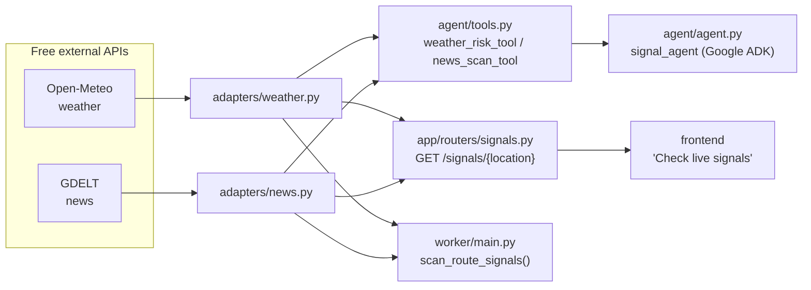

# external_api.md — The real APIs we use

SignalBridge reads two **free, no-key** public APIs to detect real-world
disruptions. Both let us **filter by location**, which is exactly what we need.

| API | What it gives us | Key needed? | Cost |
|---|---|---|---|
| **Open-Meteo** | Live weather forecast (rain, wind, storms) at any lat/lon | ❌ No | Free (non-commercial, <10k calls/day) |
| **GDELT DOC 2.0** | Live world news, searchable by place + keyword | ❌ No | Free |

> We deliberately picked key-free APIs so the prototype runs for anyone with no
> signup. Paid/authenticated options (carrier tracking, Google Weather) are
> listed at the bottom for later.

Everything fails **safe**: if an API is slow, down, or rate-limited, the adapter
returns a clear error and the app keeps working — it never crashes.

---

## 1. Open-Meteo — weather

**What it is:** a free weather-model aggregator. You give it coordinates and the
variables you want; it returns an hourly forecast.

- **Endpoint:** `GET https://api.open-meteo.com/v1/forecast`
- **Docs:** <https://open-meteo.com/en/docs>
- **Filtering:** by `latitude` / `longitude` (location), chosen `hourly` variables, and `forecast_days` (time).

### The exact call we make

```
GET https://api.open-meteo.com/v1/forecast
      ?latitude=18.95
      &longitude=72.94
      &hourly=precipitation,wind_speed_10m,wind_gusts_10m,weather_code
      &forecast_days=3
      &timezone=UTC
```

### What we do with the response

We scan the forecast and keep the **worst** values, then map them to one simple
risk level:

| Condition (worst in the window) | Risk |
|---|---|
| wind gust ≥ 60 km/h, or rain ≥ 20 mm, or thunderstorm code (95–99) | **high** |
| wind gust ≥ 40 km/h, or rain ≥ 10 mm | **medium** |
| otherwise | **low** |

Thresholds live in `backend/core/config.py` (easy to tune).

**Code:** `backend/adapters/weather.py` → `get_weather_risk(lat, lon)`
Returns: `{ ok, risk, max_precip_mm, max_wind_gust_kmh, worst_weather_code }`

### Limits & terms

Free tier is **non-commercial** and asks you to stay under ~10,000 calls/day.
Because we only check a handful of locations on a timer, we are far under that.
Attribution: data by Open-Meteo.com. For commercial/production use, Open-Meteo
offers a paid plan — see [manual_work.md](manual_work.md).

---

## 2. GDELT DOC 2.0 — news

**What it is:** a global news index that monitors coverage in 65 languages. You
search it like a search engine, with powerful filters.

- **Endpoint:** `GET https://api.gdeltproject.org/api/v2/doc/doc`
- **Docs:** <https://blog.gdeltproject.org/gdelt-doc-2-0-api-debuts/>
- **Filtering:** by phrase (a place name), boolean `OR`, `sourcecountry:`, `theme:`, `timespan`, newest-first `sort`.

### The exact call we make

For a location like *Nhava Sheva*, we build a query that means
**"this place" AND "something went wrong"**:

```
GET https://api.gdeltproject.org/api/v2/doc/doc
      ?query="Nhava Sheva" (strike OR closure OR closed OR suspended OR
              congestion OR blocked OR shutdown OR cyclone OR storm OR flood)
      &mode=artlist
      &format=json
      &timespan=3d
      &maxrecords=10
      &sort=datedesc
```

The keyword list lives in `backend/core/config.py` (`DISRUPTION_KEYWORDS`).

### What we get back

A JSON list of `articles`, each with `title`, `url`, `seendate`, `domain`,
`sourcecountry`. We keep just those fields.

**Code:** `backend/adapters/news.py` → `search_disruptions(location_name)`
Returns: `{ ok, query, count, articles[...] }`

### Limits & gotchas (important)

- **Rate limit:** about **1 request every 5 seconds**. Faster → HTTP 429. Our
  adapter detects this and returns `{ ok: false, error: "rate_limited" }`.
- **Short phrases:** GDELT returns an HTTP-200 *text* message ("phrase too short")
  instead of JSON. We detect non-JSON and return `{ ok: false, error: "no_json" }`.
- Article timestamps are *discovery* times, not the exact event time.
- A headline mentioning a port is a **lead, not proof** — the agent treats it as
  a signal to investigate, never as a confirmed closure.

---

## 3. How these flow through the app



Three things use the adapters:

1. **The ADK agent** (`signal_agent`) — its two tools call the adapters so Gemini
   can reason about live weather + news. *(This is the "using ADK" part.)*
2. **The API** — `GET /signals/{location_id}` returns both for the dashboard.
3. **The worker** — `scan_route_signals()` checks every active route on a timer
   (see [scheduler.md](scheduler.md)).

Try it:

```bash
# with the backend running on port 8000
curl "http://localhost:8000/signals/IN-JNPA"
```

---

## 4. Later / paid options (not needed now)

| API | Why you'd add it | Needs |
|---|---|---|
| **GDACS** (disaster alerts) | Structured cyclone/flood events with IDs | Free RSS/API; just attribution |
| **Google Weather API** | Google-native weather for production | GCP key + billing |
| **Carrier / container tracking** (Maersk, project44, SeaRates) | Real shipment ETAs | Paid + authorized access |
| **NewsAPI.org** | Simpler news search | Paid for production use |

Add these only after the free prototype is solid. Details in
[manual_work.md](manual_work.md).
