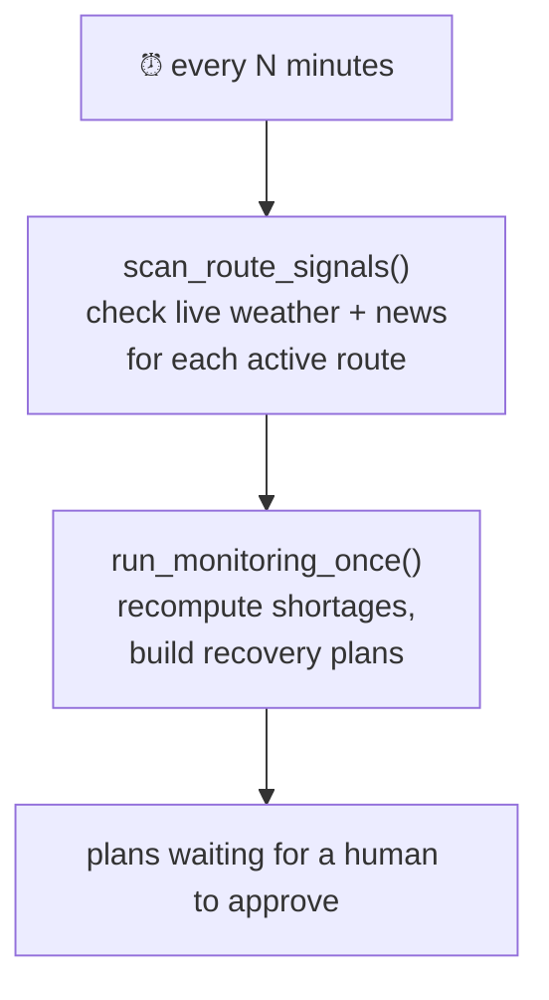
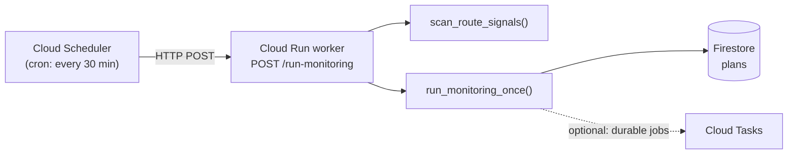

# scheduler.md — Running the monitor on a timer

SignalBridge should **check the world regularly**, not just when someone clicks a
button. That periodic trigger is the *scheduler*.

This page shows two ways to do it:
- **A. Local loop** — simplest, for the prototype on your laptop.
- **B. Cloud Scheduler + Cloud Run** — the real setup (no server running 24/7).

---

## What the scheduler actually runs

Every tick, the worker does two things (both already in
`backend/worker/main.py`):



- `scan_route_signals()` → calls the real APIs (Open-Meteo, GDELT) per location.
- `run_monitoring_once()` → recomputes exposure and builds plans for anything short.

You can run one tick by hand right now:

```bash
python -m backend.worker.main
```

---

## A. Local loop (prototype)

The simplest possible scheduler is a loop that sleeps. Good enough for a demo on
your machine. Create `scripts/run_scheduler.py`:

```python
import time
from backend.worker.main import scan_route_signals, run_monitoring_once

INTERVAL_SECONDS = 30 * 60  # every 30 minutes

if __name__ == "__main__":
    print("SignalBridge scheduler started. Ctrl+C to stop.")
    while True:
        scan_route_signals()
        run_monitoring_once()
        time.sleep(INTERVAL_SECONDS)
```

Run it:

```bash
uv run python -m scripts.run_scheduler   # or: python -m scripts.run_scheduler
```

> ⚠️ **GDELT rate limit:** ~1 request every 5 seconds. If you ever scan many
> locations in one tick, space the news calls out (add a small `time.sleep(5)`
> between them) so you don't get HTTP 429.

For a slightly nicer local option, the `APScheduler` library gives you cron-style
schedules without a manual loop — but the loop above is perfectly fine for a
prototype.

---

## B. Cloud Scheduler + Cloud Run (production)

In the cloud you don't keep a program running. Instead:



### Steps

1. **Add an endpoint the scheduler can hit.** In the backend, add a small route
   (protected so only the scheduler can call it):

   ```python
   # backend/app/routers/worker.py  (sketch)
   from fastapi import APIRouter
   from ...worker.main import scan_route_signals, run_monitoring_once

   router = APIRouter(prefix="/jobs", tags=["jobs"])

   @router.post("/run-monitoring")
   def run_monitoring():
       scan_route_signals()
       plans = run_monitoring_once()
       return {"plans_created": len(plans)}
   ```

2. **Deploy the backend to Cloud Run** (see [manual_work.md](manual_work.md)).

3. **Create the schedule** (runs every 30 minutes, calls your endpoint):

   ```bash
   gcloud scheduler jobs create http signalbridge-monitor \
     --location=asia-south1 \
     --schedule="*/30 * * * *" \
     --uri="https://YOUR-CLOUD-RUN-URL/jobs/run-monitoring" \
     --http-method=POST \
     --oidc-service-account-email=YOUR-SA@YOUR-PROJECT.iam.gserviceaccount.com
   ```

   The `--oidc-service-account-email` makes Scheduler send a signed token so only
   it can trigger the job. In the endpoint, verify that token before running.

4. **(Optional) Cloud Tasks for durable work.** If a tick finds many incidents,
   push each one as a Cloud Task so retries and rate-limiting are handled for you,
   instead of doing everything inside the single scheduler request.

### Why this shape?

- **No idle server** — you only pay when the job runs.
- **Retries built in** — Scheduler and Tasks retry on failure.
- **Separation** — the API serves users; the worker does background scanning.

---

## Picking an interval

| Signal | Suggested interval | Why |
|---|---|---|
| News (GDELT) | 30 min | News moves slowly; respects the rate limit |
| Weather (Open-Meteo) | 60 min | Forecasts update a few times a day |
| Exposure recompute | 30 min | Cheap (local math), keep it fresh |

These are starting points — tune them in `config.py` / the schedule.

---

## Checklist

- [ ] `python -m backend.worker.main` runs one tick locally ✅ (works now)
- [ ] Local loop (`scripts/run_scheduler.py`) for laptop demos
- [ ] Worker endpoint `POST /jobs/run-monitoring` (add before deploying)
- [ ] Cloud Run deploy ([manual_work.md](manual_work.md))
- [ ] `gcloud scheduler jobs create http ...`
- [ ] Verify the OIDC token in the endpoint so only Scheduler can call it
