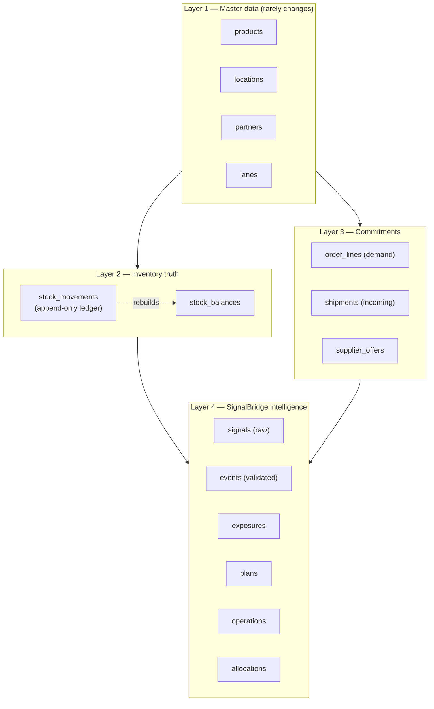
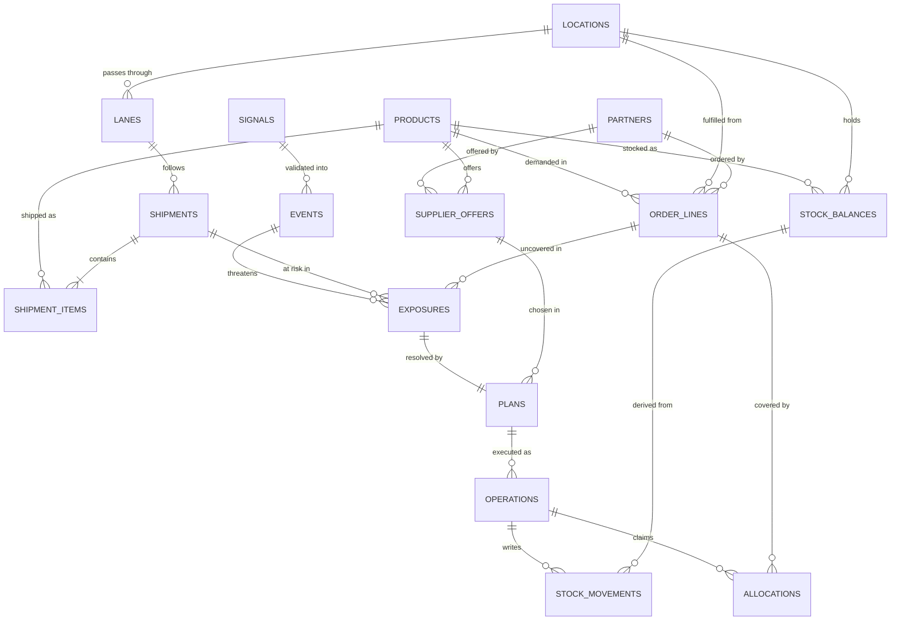
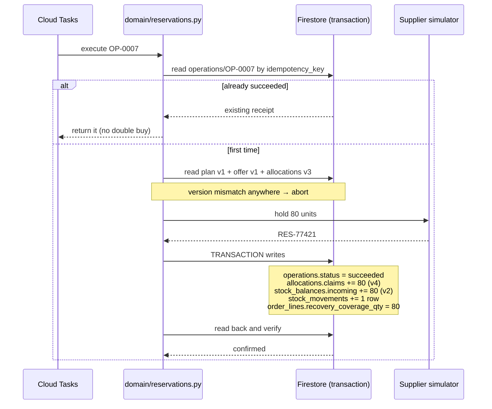

# schema.md — The database plan

**Decision doc for the SignalBridge prototype database.** Firestore (Native mode), multi-tenant, seeded with synthetic data.

Goal: a schema that is **small enough to build in days**, but shaped the way **real ERP / supply-chain systems** shape theirs — so it doesn't need a rewrite when we grow.

Read [agents.md](agents.md) first if the agents are still unclear. This file is about *where the data lives*.

---

## 1. What real systems do (our research)

Before inventing anything, here is what the industry already standardised. We borrow the **shapes**, not the complexity.

| Standard / system | What it gave us | What we take |
|---|---|---|
| **GS1 ID Keys** | `GTIN` identifies products, `GLN` identifies parties *and* locations, `SSCC` identifies logistics units, `GSIN` identifies shipments | Every product and location gets a stable ID field with room for the real GS1 key later |
| **GS1 EPCIS 2.0** | Visibility events carry **what / when / where / why / how**; v2.0 adds sensor data for cold chains and expiry of perishables | Our `events` collection uses exactly these dimensions |
| **Odoo Inventory** (stock report) | Shows *On Hand*, *Free to Use* (on-hand not reserved), *Incoming* (confirmed POs), *Outgoing* (confirmed SOs) | Our four quantity buckets, copied directly |
| **Odoo `stock.move` + `stock.quant`** / SAP material documents | Movements are an append-only ledger; balances are a derived snapshot | Our `stock_movements` + `stock_balances` split |
| **ATP (Available-to-Promise)** | *Gross ATP* = total supply. *Net ATP* = supply left after existing commitments. SAP computes it from stock + planned receipts − planned requirements | Our shortage formula |
| **SAP Business Partner** | One partner record, many roles (supplier / customer / carrier) instead of three tables | Our single `partners` collection with a `roles[]` array |
| **UN/LOCODE** | Canonical port & location codes | `locations.unlocode` for ports |

> We are **not** implementing EPCIS or GS1 fully. We are naming our fields the way they do, so the vocabulary matches what a judge or a real retailer expects.

---

## 2. The six rules we will not break

These are the decisions everything else follows from.

| # | Rule | Why |
|---|---|---|
| 1 | **Never store a number you can calculate.** `free_to_use` is derived, never saved. | Two copies of a number always drift apart. Classic inventory bug. |
| 2 | **Stock changes are a ledger, not an edit.** Append a movement, then update the balance in the same transaction. | Like a bank passbook. You can always rebuild and audit the balance. |
| 3 | **Separate raw signal from validated event.** `signals` = what we ingested. `events` = what we confirmed is real and relevant. | Lets us *show* that we filtered noise — which is the whole Triage story. |
| 4 | **Money is an integer in minor units + an ISO-4217 currency code.** ₹1,800 → `{"amount_minor": 180000, "currency": "INR"}` | Floats lose paise. Never use a float for money. |
| 5 | **Every mutable doc has `version`.** Read it, check it, write it back incremented, inside a transaction. | Optimistic locking — stops two plans buying the same stock. |
| 6 | **Only `domain/` code writes. Agents only read + propose.** | The safety model from [agents.md](agents.md). |

**Also:** all timestamps are UTC ISO-8601. All quantities are integers (no "1.5 jackets").

---

## 3. The four layers



**In one line each:**

- **Layer 1** — the nouns. Products, places, companies, routes.
- **Layer 2** — how much stock is where, right now.
- **Layer 3** — what we owe (demand) and what is coming (supply).
- **Layer 4** — what our AI noticed, decided, and did about it.

Layer 4 is the only part that is *ours*. Layers 1–3 are standard retail data any ERP would have.

---

## 4. How everything connects



---

## 5. The quantity model — the most important part

**Get this right and the whole product works. Get it wrong and every number on screen is a lie.**

We store **four** numbers per product-per-location, and derive the rest. This is copied from Odoo's stock report.

| Field | Stored? | Meaning | Wallet analogy |
|---|---|---|---|
| `on_hand_qty` | ✅ stored | Physically in the building, right now | Cash in your wallet |
| `reserved_qty` | ✅ stored | On-hand, but already promised to an order | Money you owe a friend today |
| `incoming_qty` | ✅ stored | Confirmed to arrive (open POs / shipments) | Salary arriving on the 1st |
| `outgoing_qty` | ✅ stored | Confirmed to leave | A standing EMI |
| `free_to_use` | ❌ **derived** | `on_hand − reserved` | What you can actually spend now |
| `projected_available` | ❌ **derived** | `on_hand − reserved + incoming − outgoing` | Your forecast balance |

### The shortage formula (this is ATP)

Exposure is always measured **against a deadline**, never "in general":

```text
supply_by(deadline)  = on_hand + incoming arriving on or before deadline
demand_by(deadline)  = sum of open order_line quantities due on or before deadline
shortage             = max(0, demand_by(deadline) − supply_by(deadline))
```

Our jacket example, deadline = 16 Oct:

| | Normal | After the port disruption |
|---|---:|---:|
| on_hand | 120 | 120 |
| incoming arriving in time | 500 | **0** (now arrives after the 16th) |
| supply_by(16 Oct) | 620 | 120 |
| demand_by(16 Oct) | 200 | 200 |
| **shortage** | **0** ✅ | **80** ⚠️ |

> The delay does not change `on_hand`. It changes **which bucket the 500 units fall into**. That single idea is the heart of the product.

---

## 6. Collection reference

Root path for everything: `tenants/{tenant_id}/`
Demo tenant: `tenants/buildx-demo/`

### Layer 1 — Master data

#### `products/{sku}`

```json
{
  "sku": "JACKET-BLUE-M",
  "gtin": null,
  "name": "Blue winter jacket - Medium",
  "category": "apparel",
  "uom": "EA",
  "unit_cost_minor": 120000,
  "unit_price_minor": 249900,
  "currency": "INR",
  "substitute_skus": ["JACKET-BLUE-L"],
  "perishable": false,
  "shelf_life_days": null,
  "temp_range_c": null,
  "version": 1
}
```

`unit_price_minor − unit_cost_minor` is the margin the **Margin Agent** protects.
`perishable` / `shelf_life_days` / `temp_range_c` are reserved now, used by the future perishables feature. EPCIS 2.0 supports exactly these.

#### `locations/{location_id}`

```json
{
  "location_id": "WH-MUM",
  "gln": null,
  "name": "Mumbai Distribution Centre",
  "type": "dc",
  "unlocode": "INBOM",
  "country": "IN",
  "lat": 19.08,
  "lon": 72.88,
  "aliases": ["Mumbai DC"],
  "can_transfer_to": ["DS-MUM-01", "DS-PUN-01"],
  "active": true
}
```

`type` is one of `dc` · `dark_store` · `store` · `port` · `supplier_site` · `sea_waypoint`.
**This field is what makes Internal Network Balancing possible** — the agent scans `type in (dc, dark_store)` before ever looking at an external supplier.

#### `partners/{partner_id}`

One record, many roles — the SAP Business Partner pattern.

```json
{
  "partner_id": "CUST-ACME",
  "name": "Acme Retail Pvt Ltd",
  "roles": ["customer"],
  "gln": null,
  "service_level": {
    "tier": "vip",
    "otif_target_pct": 98,
    "penalty_per_late_order_minor": 5000000,
    "sla_hours": 48
  },
  "active": true
}
```

`service_level.tier` powers **future scope #1 (VIP allocation)**.
`penalty_per_late_order_minor` is what the Margin Agent weighs, and what **future scope #2 (penalty invoicing)** would claim.

#### `lanes/{lane_id}`

The route geography (reusable across shipments). Keep the `points[]` / `legs[]` structure described in [architecture.md](architecture.md). Geography lives here; **timing lives on the shipment.**

---

### Layer 2 — Inventory truth

#### `stock_balances/{location_id}__{sku}`

Deterministic ID = no lookup needed, and no accidental duplicates.

```json
{
  "sku": "JACKET-BLUE-M",
  "location_id": "WH-MUM",
  "on_hand_qty": 120,
  "reserved_qty": 0,
  "incoming_qty": 500,
  "outgoing_qty": 0,
  "updated_at": "2026-10-10T08:00:00Z",
  "version": 1
}
```

#### `stock_movements/{movement_id}` — append-only

Never updated, never deleted. The audit trail.

```json
{
  "movement_id": "MOV-0001",
  "sku": "JACKET-BLUE-M",
  "location_id": "WH-MUM",
  "qty_delta": -80,
  "bucket": "reserved",
  "reason": "recovery_reservation",
  "ref_type": "operation",
  "ref_id": "OP-0007",
  "occurred_at": "2026-10-10T09:14:00Z",
  "actor": "system:reservation_tool"
}
```

`bucket` says *which of the four numbers* moved. `ref_id` traces back to the operation that caused it.

> **Rule:** a movement and its balance update happen **in one Firestore transaction**, or neither happens.

---

### Layer 3 — Commitments

#### `order_lines/{line_id}` — demand

```json
{
  "line_id": "LINE-001",
  "order_id": "ORDER-001",
  "customer_id": "CUST-ACME",
  "sku": "JACKET-BLUE-M",
  "location_id": "WH-MUM",
  "quantity": 200,
  "due_at": "2026-10-16T12:00:00Z",
  "status": "open",
  "on_hand_allocated_qty": 0,
  "recovery_coverage_qty": 0,
  "priority_score": null,
  "version": 1
}
```

Two separate coverage numbers on purpose:
- `on_hand_allocated_qty` — real stock, already in the building.
- `recovery_coverage_qty` — stock we have *arranged* but not received.

Never add them into one field. "Covered by a plan" ≠ "fulfilled".

#### `shipments/{shipment_id}` — incoming supply

Keep the structure from the initial design (`lane_id`, `leg_windows[]`, `items[]`, `expected_arrival_at`), plus:

```json
{
  "delay_state": "assumed_delayed",
  "assumed_arrival_at": "2026-10-19T12:00:00Z",
  "confirmed_arrival_at": null,
  "carrier_id": "CARR-XYZ"
}
```

`assumed_` vs `confirmed_` is deliberate. An assumption from a news article must **never** be displayed as a carrier-confirmed fact.

`items[]` stays an embedded array — our shipments hold a handful of SKUs, well under the Firestore **1 MiB document limit**. If a shipment ever carries hundreds of lines, split it into a `shipment_items` subcollection.

#### `supplier_offers/{offer_id}`

```json
{
  "offer_id": "OFFER-A",
  "supplier_id": "SUP-A",
  "sku": "JACKET-BLUE-M",
  "deliver_to_location_id": "WH-MUM",
  "available_qty": 90,
  "unit_price_minor": 180000,
  "shipping_minor": 500000,
  "currency": "INR",
  "delivery_latest": "2026-10-15T12:00:00Z",
  "expires_at": "2026-10-10T12:00:00Z",
  "version": 1
}
```

`version` + `expires_at` stop us reserving against a stale quote.

---

### Layer 4 — SignalBridge intelligence

#### `signals/{signal_id}` — raw, unjudged

Everything we ingested, including the junk. Keeping the junk is what lets us *prove* triage works.

```json
{
  "signal_id": "SIG-0042",
  "source": "gdelt",
  "source_url": "https://example.com/article",
  "title": "Terminal operations suspended at Nhava Sheva",
  "raw_hash": "sha256:...",
  "fetched_at": "2026-10-10T08:05:00Z",
  "published_at": "2026-10-10T06:40:00Z",
  "status": "processed",
  "ttl_at": "2026-11-09T08:05:00Z"
}
```

Set a Firestore **TTL policy** on `ttl_at` so raw signals self-delete and don't grow forever.

#### `events/{event_id}` — validated, EPCIS-shaped

```json
{
  "event_id": "EVT-0007",
  "signal_ids": ["SIG-0042"],

  "what":  { "subject_type": "location", "subject_id": "IN-JNPA" },
  "when":  { "occurred_at": "2026-10-10T06:00:00Z",
             "effective_from": "2026-10-10T06:00:00Z",
             "effective_until": "2026-10-14T06:00:00Z",
             "recorded_at": "2026-10-10T08:06:00Z" },
  "where": { "location_id": "IN-JNPA", "unlocode": "INNSA" },
  "why":   { "event_type": "port_suspension", "biz_step": "departing",
             "disposition": "in_transit_blocked" },

  "confidence": 0.82,
  "verification_status": "corroborated",
  "is_assumption": true,
  "matched_shipment_ids": ["SHP-001"],
  "superseded_by": null,
  "version": 1
}
```

The `what / when / where / why` grouping is lifted straight from EPCIS 2.0. It gives us a vocabulary judges recognise, and it keeps evidence tidy.

`is_assumption` is our honesty flag. `superseded_by` handles a later notice correcting an earlier one — without deleting history.

#### `exposures/{exposure_id}` — the Triage Agent's output

```json
{
  "exposure_id": "EXP-0003",
  "event_id": "EVT-0007",
  "shipment_id": "SHP-001",
  "sku": "JACKET-BLUE-M",
  "location_id": "WH-MUM",
  "deadline_at": "2026-10-16T12:00:00Z",
  "supply_by_deadline": 120,
  "demand_by_deadline": 200,
  "shortage_qty": 80,
  "affected_order_line_ids": ["LINE-001"],
  "revenue_at_risk_minor": 19992000,
  "penalty_at_risk_minor": 5000000,
  "severity": "high",
  "triage_decision": "actionable",
  "computed_at": "2026-10-10T08:07:00Z"
}
```

Every input to the calculation is stored, so any number on screen can be explained. Rows with `triage_decision: "ignored"` are kept too — that is the "we filtered 49 of 50" evidence.

#### `plans/{plan_id}` — the Recovery + Governance output

```json
{
  "plan_id": "PLAN-0005",
  "exposure_id": "EXP-0003",
  "plan_type": "replacement_purchase",
  "status": "awaiting_approval",

  "options": [
    { "rank": 1, "source": "supplier", "offer_id": "OFFER-A", "offer_version": 1,
      "qty": 80, "cost_minor": 14900000, "arrives_at": "2026-10-15T12:00:00Z",
      "feasible": true,  "reason": "Covers all 80 units before the deadline." },
    { "rank": 2, "source": "internal", "from_location_id": "DS-PUN-01",
      "qty": 0, "cost_minor": 0, "feasible": false,
      "reason": "No free stock in any internal DC or dark store." },
    { "rank": 3, "source": "supplier", "offer_id": "OFFER-C",
      "qty": 80, "cost_minor": 13600000, "arrives_at": "2026-10-20T12:00:00Z",
      "feasible": false, "reason": "Arrives 4 days after the deadline." }
  ],
  "selected_option_rank": 1,

  "margin_check": {
    "recovery_cost_minor": 14900000,
    "protected_revenue_minor": 19992000,
    "penalty_avoided_minor": 5000000,
    "net_benefit_minor": 10092000,
    "verdict": "worth_it"
  },

  "surplus_forecast": {
    "late_units_arriving": 500,
    "expected_surplus_qty": 80,
    "surplus_at": "2026-10-19T12:00:00Z",
    "suggested_action": "markdown"
  },

  "approval": {
    "tier": "regional_manager",
    "threshold_minor": 10000000,
    "required_role": "manager",
    "approved_by": null,
    "approved_at": null,
    "decision": null
  },

  "narrative": "Port suspension at Nhava Sheva delays 500 jackets past the 16 Oct deadline, leaving 80 units uncovered for Acme (VIP). No internal stock available. Supplier A covers all 80 by 15 Oct for ₹1,49,000, protecting ₹1,99,920 of revenue and a ₹50,000 OTIF penalty.",
  "version": 1
}
```

**Rejected options are stored with their reason.** That is the single most convincing thing on the demo screen — it proves the AI compared alternatives instead of picking the first hit.

`narrative` is the one field Gemini writes directly. Every number inside it came from a tool.

#### `operations/{operation_id}` — safe execution

```json
{
  "operation_id": "OP-0007",
  "plan_id": "PLAN-0005",
  "plan_version": 1,
  "idempotency_key": "PLAN-0005:v1:OFFER-A:v1:80",
  "status": "succeeded",
  "attempts": 1,
  "reservation": {
    "supplier_ref": "RES-77421",
    "qty": 80,
    "expires_at": "2026-10-11T12:00:00Z",
    "verified_at": "2026-10-10T09:14:05Z"
  },
  "last_error": null,
  "updated_at": "2026-10-10T09:14:05Z"
}
```

`idempotency_key` is the retry guard. Cloud Tasks retries on timeout; if the key already exists as `succeeded`, we return the existing result instead of buying 80 more jackets.

#### `allocations/{line_id}` — stops double-covering

```json
{
  "line_id": "LINE-001",
  "claims": [
    { "operation_id": "OP-0007", "qty": 80, "state": "confirmed",
      "claimed_at": "2026-10-10T09:14:05Z" }
  ],
  "version": 3
}
```

Two plans cannot both "rescue" the same 80 units — the second one fails the version check.

---

## 7. How we wire it

### Paths and IDs

```text
tenants/buildx-demo/products/JACKET-BLUE-M
tenants/buildx-demo/stock_balances/WH-MUM__JACKET-BLUE-M
tenants/buildx-demo/events/EVT-0007
```

- **Composite IDs use `__`** (double underscore). Firestore document IDs cannot contain `/`.
- **Deterministic IDs** (`{location}__{sku}`) where a natural key exists → no duplicates possible.
- **Readable prefixed IDs** (`PLAN-0005`) for the demo. Real systems use ULID/UUID; swap later, nothing else changes.
- Everything is **under the tenant**, so one security rule covers the whole database.

### Who reads what, who writes what

| Component | Reads | Writes |
|---|---|---|
| `adapters/news.py` | — | `signals` |
| Triage Agent → `exposure_tool` | `events`, `shipments`, `order_lines`, `stock_balances` | `exposures` |
| Recovery Agent → `network_balance_tool` | `stock_balances`, `locations` | — |
| Recovery Agent → `supplier_tool` | `supplier_offers` | — |
| Recovery Agent → `margin_tool` | `products`, `partners`, `order_lines` | — |
| Recovery Agent → `surplus_tool` | `shipments`, `order_lines` | — |
| Governance Agent | `plans` | `plans.approval` |
| Approval API | `plans` | `plans.status` |
| `domain/reservations.py` | `plans`, `operations` | `operations`, `allocations`, `stock_balances`, `stock_movements` |

> Notice: **only the last row writes inventory.** Every agent tool above it is read-only. That is the safety boundary, enforced by which client each module is given.

### The one transaction that matters



**All five writes land together, or none do.** That is what "verified recovery" means on the dashboard.

### Indexes we will need

Firestore auto-indexes single fields. These composite ones must be declared in `infra/firestore.indexes.json`:

| Collection | Fields |
|---|---|
| `order_lines` | `status` ASC, `due_at` ASC |
| `order_lines` | `sku` ASC, `location_id` ASC, `due_at` ASC |
| `shipments` | `status` ASC, `expected_arrival_at` ASC |
| `events` | `verification_status` ASC, `effective_from` DESC |
| `exposures` | `triage_decision` ASC, `severity` ASC, `computed_at` DESC |
| `plans` | `status` ASC, `version` DESC |
| `stock_balances` | `sku` ASC, `on_hand_qty` DESC *(internal balancing scan)* |

### Security rules, in one idea

```javascript
match /tenants/{tenantId}/{document=**} {
  allow read:  if isMember(tenantId);
  allow write: if false;   // only the backend service account writes
}
```

The browser **never** writes business data. All writes go through the Cloud Run API, which checks the Firebase Auth token and the user's role before calling `domain/`.

### Staying inside the free tier

Firestore's free quota is **20,000 writes/day** and **50,000 reads/day**, 1 GiB stored. Our demo tenant (~10 SKUs, ~10 shipments, ~50 order lines) uses a tiny fraction. Two habits keep it that way:

- Batch the seed script instead of writing docs one by one.
- Put a **TTL policy on `signals.ttl_at`** so raw ingested noise expires automatically.

---

## 8. Build order

Don't create 16 collections on day one. Build in tiers — the demo must work at the end of **Tier 1**.

### Tier 1 — make the core loop work (build first)

`products` · `locations` · `stock_balances` · `order_lines` · `shipments` · `supplier_offers` · `events` · `plans`

Eight collections. This is enough to show: *disruption → shortage → option → approve.*
Shortcut allowed here: skip `signals` and seed `events` directly from a fixture; put exposure numbers inside the plan.

### Tier 2 — make it trustworthy

`stock_movements` · `allocations` · `operations` · `exposures` · `signals`

This is what turns a demo into a system: audit trail, idempotency, no double-booking, visible noise filtering.

### Tier 3 — make it rich

`partners` · `lanes` · `audit_log`

Unlocks VIP tiers, OTIF penalties, and multi-leg route monitoring.

### Tier 4 — future scope (schema ready, not built)

| Feature | What it needs | Already reserved? |
|---|---|---|
| VIP / SLA allocation | `partners.service_level.tier`, `order_lines.priority_score` | ✅ fields exist |
| Penalty & insurance claims | new `claims` collection + `audit_log` evidence bundle | 🔜 fields exist, collection pending |
| Perishables rescue | `products.perishable`, `shelf_life_days`, `temp_range_c` | ✅ fields exist |

We deliberately added those fields **now** (they cost nothing empty) so the roadmap slide is credible — the data model already supports it.

---

## 9. Cheat sheet

| Question | Answer |
|---|---|
| Where does everything live? | `tenants/{tenant_id}/{collection}/{doc_id}` |
| How many collections? | 16 total · **8 for Tier 1** |
| How is stock stored? | 4 buckets: on_hand, reserved, incoming, outgoing |
| How is "available" found? | Derived: `on_hand − reserved`. Never stored. |
| What's the shortage formula? | `max(0, demand_by(deadline) − supply_by(deadline))` |
| How do we avoid double-buying? | `operations.idempotency_key` + `version` checks in a transaction |
| How do we audit a change? | `stock_movements` — append-only, never edited |
| Who can write? | Backend service account only. Agents read, humans approve. |
| Money format? | Integer minor units + ISO-4217 code |
| Which standards did we follow? | GS1 ID Keys, EPCIS 2.0 (what/when/where/why), Odoo stock buckets, ATP |

---

## 10. Sources

- GS1 ID Keys — GTIN / GLN / SSCC / GSIN definitions: <https://www.gs1.org/standards/id-keys>
- GS1 EPCIS 2.0 & CBV (what/when/where/why, sensor + perishable support): <https://www.gs1.org/standards/epcis>
- Odoo 18 Inventory stock report (On Hand / Free to Use / Incoming / Outgoing): <https://www.odoo.com/documentation/18.0/applications/inventory_and_mrp/inventory/warehouses_storage/reporting/stock.html>
- Available-to-Promise (gross vs net ATP): <https://en.wikipedia.org/wiki/Available-to-promise>
- Firestore data modelling: <https://firebase.google.com/docs/firestore/manage-data/structure-data>
- Firestore usage & limits (1 MiB doc, free-tier quotas): <https://firebase.google.com/docs/firestore/quotas>
