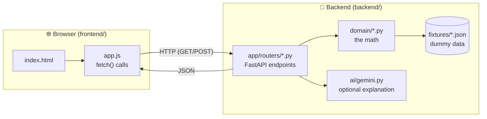
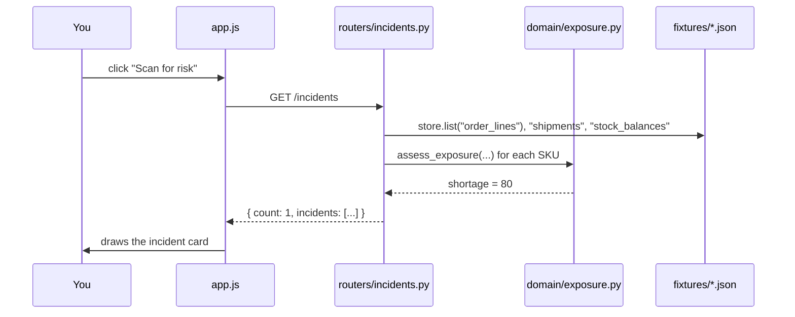

# simple.md — How the code is wired (the beginner version)

You said the wiring is hard to follow. This page traces **one real click**
through the actual files, so you can see exactly what calls what. No jargon.

---

## The whole app in one picture

There are only **two programs**:

1. **Frontend** — a web page (`frontend/`) that runs in your browser.
2. **Backend** — a Python API (`backend/`) that does the thinking.

They talk over HTTP. That's it.



The browser never touches the data or the math. It only draws what the backend
sends back.

---

## Follow one click: "Scan for risk"

Here is what happens, file by file, when you click the button.



### The same thing in words

1. **You click** the button. In `frontend/app.js`, the function `scanIncidents()` runs.
2. It calls `api("/incidents")`, which does `fetch("http://localhost:8000/incidents")`.
3. That request lands in `backend/app/routers/incidents.py`, function `list_incidents()`.
4. That function reads the dummy data through `store.list(...)` (from `backend/core/store.py`, which just reads the JSON files in `fixtures/`).
5. For each product it calls `assess_exposure(...)` in `backend/domain/exposure.py` — the pure math that returns the shortage.
6. The endpoint sends back JSON: `{ count: 1, incidents: [...] }`.
7. Back in `app.js`, `incidentCard(...)` turns that JSON into the card you see.

**Nothing magic.** Every arrow above is one function calling another.

---

## The three screens = three endpoints

| You do this on screen | Frontend function (`app.js`) | Calls this endpoint | Which runs |
|---|---|---|---|
| Click **Scan for risk** | `scanIncidents()` | `GET /incidents` | `routers/incidents.py` → `domain/exposure.py` |
| Click an **incident card** | `loadPlan()` | `GET /plans/{sku}/{loc}` | `routers/plans.py` → `domain/planner.py` |
| Click **Explain with AI** | `explain-btn` handler | `GET /plans/{sku}/{loc}/explain` | `routers/plans.py` → `ai/gemini.py` |
| Click **Approve & reserve** | `approve-btn` handler | `POST /plans/{sku}/{loc}/approve` | `routers/plans.py` → `domain/reservations.py` |

So the frontend is just **4 fetch calls**. The backend is just **4 endpoints**.
If you understand those 4 lines, you understand the whole app.

---

## Where each file sits (and why)

```text
frontend/
  index.html   the page layout (buttons, panels)
  style.css    how it looks
  app.js       the 4 fetch calls + drawing the results

backend/
  app/
    main.py              starts FastAPI, turns on CORS (lets the browser call us)
    routers/incidents.py GET /incidents
    routers/plans.py     GET /plans, GET /explain, POST /approve
  domain/
    exposure.py          shortage math        <-- the heart
    planner.py           builds the full plan (calls the others)
    margin.py            is it worth it?
    network_balance.py   use our own stock first
    surplus.py           future overstock warning
    governance.py        who approves
    reservations.py      hold the stock once
  ai/
    gemini.py            optional: plain-English explanation via Gemini
  core/
    store.py             reads fixtures/*.json (swap to Firestore later)
    config.py            reads .env
  fixtures/*.json        the dummy data
```

**Rule to remember:** the browser asks, a **router** answers, the router calls
**domain** for the math, and domain reads **fixtures** for the data. One
direction, every time.

---

## "Where does Gemini come in?"

Only in **one place**: the **Explain with AI** button → `GET /explain` →
`backend/ai/gemini.py`. It takes the finished plan and asks Gemini to write a
friendly paragraph. If there's no key, it just returns the plan's built-in
sentence instead — so the app works with or without AI.

Everything else (the shortage, the cost, the decision) is done by plain Python
in `domain/`. Gemini never does the math. That is on purpose — see
[agents.md](agents.md).

---

## Run it (two terminals)

See [start.md](start.md) for full setup. The short version:

```bash
# terminal 1 — backend
cd signalbridge
uv run uvicorn backend.app.main:app --reload --port 8000

# terminal 2 — frontend
cd signalbridge/frontend
python3 -m http.server 5173
```

Then open **http://localhost:5173** and click **Scan for risk**.
